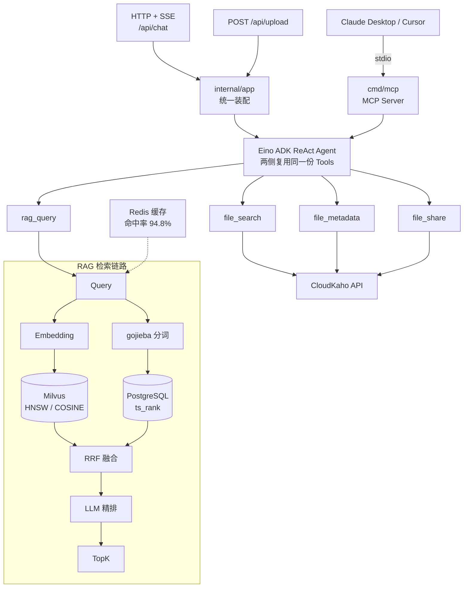
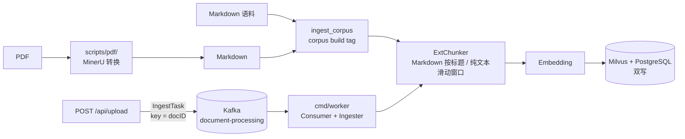
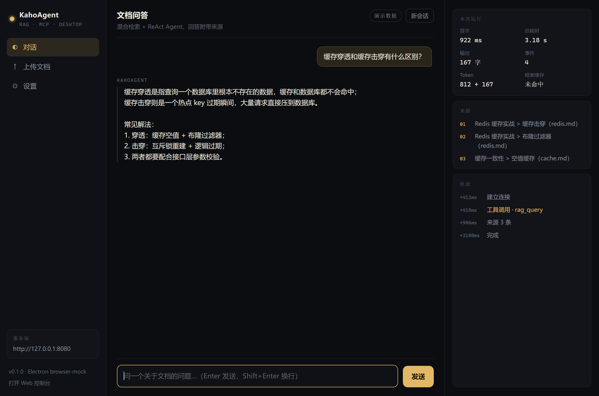

# KahoAgent

> 基于 CloudWeGo Eino 的智能文件助手 — RAG 混合检索 + ReAct Agent + MCP 协议暴露

用自然语言检索 [CloudKaho](https://github.com/yurin-kami/CloudKaho) 云盘中的文档内容，
同时以 MCP 协议把能力暴露给 Claude Desktop / Cursor 等客户端直接调用。

**核心指标**（全部实测，方法见 [docs/spike-evidence/phase5.md](docs/spike-evidence/phase5.md)）：

| 指标 | 实测值 |
|---|---|
| Recall@5（hybrid + rerank） | 0.441 |
| MRR（hybrid + rerank） | 0.818 |
| 端到端首字延迟 P50 / P99 | 409ms / 1388ms |
| 检索缓存命中率 | 94.8% |
| 常驻内存 | 23.9 MB |
| MCP 工具调用吞吐 | 69.7 call/s |

## 架构



文档入库有**两条**路径：HTTP 上传走 Kafka 异步链路（在线），
语料重建走离线脚本（批量、可重复执行）：



> 两条路径共用同一个 `Ingester`（`internal/pipeline/ingest.go`），
> 差别只在触发方式：上传要的是「立刻返回、后台处理」，
> 语料重建要的是「一个人盯着跑完、失败立刻重来」。
> 共用实现保证两边的分块、幂等、双写逻辑不会分叉。
>
> ⚠️ 上传的文档上限是 **640KB 原文**（`pipeline.MaxRawBytes`）：
> Kafka 单条约 900KB，而 `[]byte` 会被 JSON 编码成 base64 膨胀 4/3。
> 更大的文档应该走离线脚本，或先做分片 —— 见[已知限制](#已知限制)。

## 技术栈

- **语言**：Go 1.25
- **AI 框架**：[CloudWeGo Eino](https://github.com/cloudwego/eino) v0.9.14（ADK ReAct Agent）
- **MCP**：[modelcontextprotocol/go-sdk](https://github.com/modelcontextprotocol/go-sdk) v1.7.0（官方 Go SDK）
- **向量数据库**：Milvus（HNSW，M=16 / efConstruction=200 / COSINE）
- **全文检索**：PostgreSQL `ts_rank` + [gojieba](https://github.com/yanyiwu/gojieba) 中文分词
- **消息队列**：Kafka（文档异步入库：上传 → Kafka → worker → 双写 Milvus/PG）
- **缓存**：Redis（查询向量 + 检索结果）
- **LLM**：任意 OpenAI 兼容服务；对话与 embedding 可分开配置（如 DeepSeek chat + DashScope embedding）
- **HTTP**：标准库 `net/http` + SSE
- **可观测性**：Prometheus + 标准库 `log/slog` + pprof + OpenTelemetry（OTLP/HTTP → Jaeger）
- **评测**：78 条 golden set + 回归门禁（`-baseline` 对比，跌幅超阈值失败）
- **桌面端**：Electron 40（`desktop/`，流式对话 / 来源 / 用量 / 上传）

> HTTP 与日志都用标准库，没有引入 Gin / Zap：
> 本项目只有一个 POST 端点和一个健康检查，`http.ServeMux` 足够；
> 少一层框架，SSE 的刷写时机和 context 取消行为就少一层不确定性。

## 对话与 embedding 可以是两家

DeepSeek 只提供 chat，没有 `/embeddings`。项目把两者拆成了独立配置：

```toml
[llm]
# 对话：DeepSeek
api_key  = "sk-..."
base_url = "https://api.deepseek.com"
model    = "deepseek-flash"        # 推理模型，回答质量好但慢
rerank_model = "deepseek-chat"     # 精排用非推理模型，见下方说明

# 向量化：另一家，或本地服务
embedding_base_url = "http://127.0.0.1:11435/v1"
embedding_api_key  = "local"
embedding_model    = "bge-small-zh-v1.5"
embedding_dim      = 512
```

> ⚠️ **精排不要用推理模型**：`deepseek-flash` 会先输出 `reasoning_content`，
> 逐条打分时 token 预算被 reasoning 吃光，`content` 为空，表现为
> 「所有候选都解析不出分数」并回退 RRF。用 `rerank_model` 指到
> `deepseek-chat` 即可；`Score` 的 token 预算也已放宽到 256 兜底。

`embedding_*` 留空时回退到主模型配置，兼容「DashScope 同时做 chat 与 embedding」
的单供应商部署。启动时会校验：如果 embedding 仍指向 DeepSeek，直接报错并提示，
而不是等到第一次入库才出现一个没有上下文的 404。

本地 embedding 服务见 [scripts/local-embed](scripts/local-embed/README.md)：
ONNX 小模型（bge-small-zh-v1.5，512 维，约 23MB），零云依赖。

## 目录结构

```
KahoAgent/
├── cmd/
│   ├── server/          # HTTP API 入口（对话 + 上传）
│   ├── worker/          # Kafka 消费进程（分块 → 向量化 → 双写）
│   └── mcp/             # MCP Server 入口（stdio / http）
├── internal/
│   ├── app/             # 依赖装配（HTTP 与 MCP 共用，可被测试 import）
│   ├── agent/           # Eino ReAct 编排、会话记忆与压缩
│   │   └── tools/       # 四个业务工具的实现
│   ├── rag/
│   │   ├── chunker/     # 按标题层级分块
│   │   ├── retriever/   # 混合召回 + RRF 融合 + LLM 精排
│   │   └── tokenizer/   # gojieba 分词（供 BM25 用）
│   ├── mcp/server/      # Tools → MCP 的通用桥接 + 限流/超时/审计
│   ├── pipeline/        # Kafka 入库：producer / consumer / ingester
│   ├── handler/         # HTTP handler（SSE 流式响应）
│   ├── metrics/         # Prometheus 指标
│   ├── trace/           # OpenTelemetry 初始化 + HTTP 埋点中间件
│   ├── eval/            # 检索评估指标计算 + 回归门禁
│   └── config/          # 配置加载
├── pkg/
│   ├── llm/             # LLM 客户端（Chat / Embedding / 流式）
│   ├── vectorstore/     # Milvus 封装
│   ├── cache/           # Redis 封装
│   └── cloudkaho/       # CloudKaho API 客户端
├── migrations/          # PostgreSQL 建表与索引
├── desktop/             # Electron 桌面客户端（main/preload/renderer）
├── scripts/
│   ├── local-stack.sh   # podman 起依赖栈（WSL 下绕开 compose 的 mem_limit）
│   ├── e2e-upload.sh    # 端到端验收：上传 → Kafka → worker → 检索
│   ├── eval/            # 检索评估（-tags=eval）
│   ├── e2e/             # 验收用的 fakellm 桩与检索检查工具（-tags=e2echeck）
│   ├── bench/           # 开环压测（-tags=loadtest）
│   ├── pdf/             # PDF → Markdown 离线预处理（Python，不进镜像/CI）
│   └── spike/           # 技术验证脚本
└── docs/
    ├── IMPLEMENTATION.md   # 分阶段实施方案
    ├── STUDY-GUIDE.md       # 源码学习指南（中文、逐段注释、自测题）
    ├── LEARNING.md          # 完整学习清单（计划认知 + 实测修正）
    ├── eval-results.md     # 检索策略评估结果
    ├── eval-results-pdf.md # PDF 语料评估（含 Markdown 对照组）
    ├── pdf-plan-b.md       # PDF 支持实施方案（已执行）
    ├── optimization.md     # pprof 定位与优化前后对比
    ├── deployment.md       # 容器化与部署
    └── spike-evidence/     # 各阶段验收证据
```

## Quick Start

```bash
git clone https://github.com/yurin-kami/KahoAgent.git
cd KahoAgent

# 1. 配置
cp config.example.toml config.toml
# 编辑 config.toml；API Key 建议走环境变量而非写进文件：
export DASHSCOPE_API_KEY=sk-xxx

# 2. 启动依赖
docker compose up -d          # Milvus + PostgreSQL + Redis + Kafka
psql -f migrations/001_chunks.sql
# podman/WSL 下用（compose 的 mem_limit 在 WSL 机器上不可用）：
#   bash scripts/local-stack.sh up

# 2.5 如果用 DeepSeek 做对话：它没有 embedding 接口，另起本地向量服务
#     （或者在 config.toml 里把 embedding_base_url 指向 DashScope / SiliconFlow）
bash scripts/local-embed/run.sh

# 3. 运行
go run ./cmd/server           # HTTP 服务，默认 :8080
go run ./cmd/worker           # Kafka 消费进程（异步入库），指标 :9191
go run ./cmd/mcp              # MCP 服务（stdio）
```

试一下：

```bash
curl -N -X POST http://127.0.0.1:8080/api/chat \
  -H "Content-Type: application/json" \
  -d '{"session_id":"demo","message":"缓存穿透怎么解决？"}'
```

会以 SSE 逐字返回，中间可以看到 `{"type":"tool","tool":"rag_query"}` 这样的
工具调用事件。

上传文档（立刻返回 `202`，由 worker 异步分块、向量化并双写 Milvus/PostgreSQL）：

```bash
curl -X POST http://127.0.0.1:8080/api/upload \
  -F "doc_id=redis.md" \
  -F "file=@docs/sample.md"
```

也接受 JSON：`{"doc_id":"redis.md","content":"..."}`。
`doc_id` 缺省时用内容哈希兜底；重复上传同名文档会覆盖旧版本
（worker 会先清空该 docID 的旧块，避免文档变短后残留尾部内容）。

> ⚠️ gojieba 基于 cgo，构建需要 C++ 工具链（`g++`）。
> Windows 下需装 MinGW-w64 或在 WSL 里构建。

## 端点

| 路径 | 说明 |
|---|---|
| `POST /api/chat` | 对话（SSE 流式） |
| `POST /api/upload` | 上传文档（multipart 或 JSON），返回 202 并投递 Kafka |
| `GET /` | 内嵌 Web 控制台（零依赖单页） |
| `GET /static/*` | 控制台静态资源 |
| `GET /healthz` | 健康检查 |
| `GET /metrics` | Prometheus 指标 |
| `GET /debug/pprof/` | 性能剖析 |

worker 的指标在独立端口（默认 `:9191/metrics`，可用
`KAHO_WORKER_METRICS_ADDR` 覆盖），与 server 分开抓取。

### 链路追踪

指标告诉你「rerank 的 P99 是 1.9s」，trace 告诉你**是哪一次请求、慢在哪一段**。
两者不是替代关系。

```bash
# 1. 起 Jaeger（compose 里已配好，UI 在 :16686）
podman-compose up -d jaeger

# 2. 打开追踪
#    config.toml 里设 [otel] enabled = true（默认关闭，端点是 127.0.0.1:4318）

# 3. 发一次请求后打开 http://127.0.0.1:16686
```

一次检索会看到这样的瀑布：`POST /api/chat` → `retrieval.hybrid` →
`retrieval.vector` / `retrieval.bm25`（并发）→ `rerank.llm`。
入库路径是 `kafka.consume` → `ingest.document`。

> ⚠️ 两个容易踩的点：
> 1. `otel.endpoint` **不能带 `http://`**，OTLP exporter 只接受 `host:port`。
> 2. 追踪中间件会包装 `ResponseWriter`，必须转发 `http.Flusher`，
>    否则 SSE 会被埋点代码弄坏（`internal/trace` 里有专门的回归测试）。

### Web 控制台

启动 server 后打开 <http://127.0.0.1:8080/>，是一个内嵌的单页控制台：

- 流式回答（SSE 逐字渲染）
- **来源面板**：显示本轮检索命中的片段来源（标题路径 + 文件名），
  数据来自 `sources` 事件，而不是让前端去猜模型输出里的引用标记
- **运行轨迹**：工具调用、来源推送、耗时，带相对时间戳
- 本次运行的首字延迟、总耗时、输出字数、事件数（浏览器实测）

前端只有三个文件（`internal/web/static/`），`go:embed` 进二进制，
没有 Node 构建链、没有 CDN 依赖。同源部署，CSP 禁止内联脚本。

> 为什么不做成 React 应用：这个项目的展示重点是后端链路。
> 引入前端工程化会让「clone 下来 `go run` 就能用」变成
> 「先装 pnpm 再 build」，而控制台本身的信息密度并不需要框架。

### 桌面端（Electron）

`desktop/` 是一个独立的 Electron 客户端，直连同一个服务端：

- 原生窗口、文件选择上传、服务器地址持久化
- 流式对话、来源面板、运行轨迹、Token/缓存用量
- 主进程负责网络（渲染进程 `connect-src 'none'`），避开 CORS 并保持最小权限
- preload 只暴露 9 个窄接口，`contextIsolation` + `sandbox` 全开



```bash
cd desktop && npm install && npm start   # 需先启动 server/worker
```

## 工具

| 工具 | 用途 |
|---|---|
| `rag_query` | 语义检索文档内容，返回带出处的片段 |
| `file_search` | 按文件名/类型搜索网盘文件 |
| `file_metadata` | 查询单个文件的大小、时间等元信息 |
| `file_share` | 生成文件分享链接 |

后三个需要 CloudKaho 凭证（`CLOUDKAHO_TOKEN`）；未配置时会自动禁用，
`rag_query` 仍可正常使用。

> 未配凭证时 MCP 的 `tools/list` 只会返回 **1 个**工具，启动日志里也会有
> `tools=1` 与一条 WARN。这是预期的降级行为，不是握手失败 ——
> 在 Claude Desktop 里看到只有一个工具可用时，先检查这个环境变量。

## MCP 集成（Claude Desktop）

在 `claude_desktop_config.json` 中添加：

```json
{
  "mcpServers": {
    "kahoagent": {
      "command": "/path/to/KahoAgent/kaho-mcp",
      "env": {
        "KAHO_CONFIG": "/path/to/KahoAgent/config.toml",
        "DASHSCOPE_API_KEY": "sk-xxx"
      }
    }
  }
}
```

> 用编译好的二进制而不是 `go run`：`go run` 每次启动都要编译，
> 而 cgo 编译需要数秒，Claude Desktop 会在 MCP 握手超时前就放弃连接。
> 先 `go build -o kaho-mcp ./cmd/mcp`。

## 容器化

```bash
docker build -t kahoagent .

docker run -p 8080:8080 \
  -v ./config.toml:/etc/kaho/config.toml:ro \
  -e KAHO_CONFIG=/etc/kaho/config.toml \
  -e DASHSCOPE_API_KEY=sk-xxx \
  kahoagent
```

镜像约 **150MB**（三个二进制共用同一份依赖；其中 `kaho-worker` 是新增的
第三个 cgo 二进制，按前两个各 41MB 估算，尚未在容器内重新实测），
config.toml 不打进镜像（含密钥），以非 root 运行。
体积构成与取舍见 [docs/deployment.md](docs/deployment.md)。

## 测试

```bash
go test ./...                      # 单元测试，不需要任何外部服务
go test -race ./...                # 竞态检测（CI 跑这个）
go test -tags=integration ./...    # 需要 Milvus / PostgreSQL / Redis / Kafka
go test -tags=e2e ./...            # 需要上述服务 + 真实 LLM API Key
```

分层的原因：单元测试必须能在任何机器上秒级跑完，否则没人会在提交前跑；
需要真实依赖的测试单独打标签，CI 只跑不带标签的那部分。

### 本地起依赖 + 端到端验收

`docker-compose.yml` 里每个服务都写了 `mem_limit`，在 podman 的 WSL 机器上
会因缺少 cgroup memory 控制器启动失败。用脚本直接 `podman run`：

```bash
bash scripts/local-stack.sh up               # etcd/minio/milvus/pg/redis/kafka
bash scripts/local-stack.sh status
bash scripts/local-stack.sh down             # 保留数据卷

# 上传 → Kafka → worker → 双写 → 混合检索（用 fakellm 桩，不烧 API 额度）
bash scripts/e2e-upload.sh
```

> ⚠️ gojieba 是 cgo + C++，**Windows 原生下运行时崩溃**（编译能过）。
> 集成测试与端到端验收都在 WSL / Linux 里跑；本仓库的验证方式：
> `wsl -d <distro> -e bash -lc "cd <repo> && go test -tags=integration ./..."`。

评估与压测：

```bash
go run -tags=eval ./scripts/eval/eval.go        # 检索策略对比 → docs/eval-results.md
go run -tags=eval ./scripts/eval/eval.go -rerank -json eval-report.json \
  -baseline docs/eval-baseline.json             # 带回归门禁：跌幅 > 0.02 直接失败
go run -tags=loadtest ./scripts/bench/load.go   # 开环压测
go test -bench=. -benchmem ./internal/rag/retriever/
```

门禁的判定规则（`internal/eval/gate.go`）：

- golden set 条数变化 → 直接失败（换了题目就没法比分数）
- 任一路策略的 Recall@5 或 MRR 绝对跌幅 > 0.02 → 失败
- 基线里有的策略本轮缺失 → 失败（不带 `-rerank` 时会先裁剪基线并打印跳过项）
- 确认是有意变更后，把新的 `eval-report.json` 提交为基线即可

## 稳定性

单点故障时的降级矩阵（每一行都有对应的测试或实测记录）：

| 故障 | 兜底 | 代价 |
|---|---|---|
| 上游 429 / 5xx | 切备用模型（`llm.fallback_model`），**只在流式开始前**切换 | 备用模型能力弱一些；已开始的流不切，否则两段回答会拼接 |
| 连续失败 | 熔断 30s，直接返回「服务暂时不可用」 | 冷却期内不重试，避免把连接池耗在必然失败的请求上 |
| 精排失败 | 回退 RRF 顺序 | 质量下降，但答案仍然给出 |
| 向量路失败 | BM25 单路检索 | 口语化 query 的召回变差 |
| PostgreSQL 不可用 | server 降级纯向量；worker 拒绝启动 | worker 必须双写，只写一半会让 BM25 永久缺数据 |
| Redis 不可用 | 缓存与会话记忆禁用 | 多轮上下文丢失、延迟上升 |
| 历史过长 | 从最旧的消息丢到预算内（`max_history_chars`） | 更早的上下文丢失，但不报错 |
| 上传超过 640KB | 413 + 明确提示 | 需要走离线脚本或分片 |
| 单篇入库连续失败 | 进程内重试 `max_attempts` 次后转投 `<topic>.dlq` 并提交 offset | 消息不再阻塞分区；需要人工回放 |

> 熔断和主备切换共用一份实现（`pkg/llm/failover.go`），
> 精排模型和对话模型的行为不会分叉 —— 否则排查时会遇到
> 「精排切了备用、对话没切」这种最难定位的不一致。

## 已知限制

- **HTTP 吞吐约 10 req/s**，瓶颈是 DashScope 账号并发配额而非本服务
  （三组独立证据见 [phase5.md](docs/spike-evidence/phase5.md)）。MCP 侧不经过
  生成环节，实测 69.7 call/s。
- **`confusable` 类查询样本仅 8 条**，该维度的指标只适合看趋势。
- **镜像约 150MB**，达不到最初设定的 30MB —— cgo 二进制与 13.8MB 中文词典
  是主要构成，取舍说明见 [docs/deployment.md](docs/deployment.md)。
- **上传单篇上限 640KB 原文**（`pipeline.MaxRawBytes`）。限制来自 Kafka
  单条消息约 900KB，而 Go 的 JSON 编码会把 `[]byte` 转成 base64、体积膨胀
  4/3，所以原文必须留出余量。更大的文档走离线脚本
  （`scripts/eval/ingest_corpus.go`）或先分片 —— 分片意味着要处理
  「同一 docID 的多个部分如何合并」，当前没做。
- **没有删除/更新接口**。重新上传同名文档会覆盖（worker 先按 docID 清旧块），
  但「删除文档」只能调 `Ingester.Delete` 或直接操作两个存储。
- **死信队列已实现，但没有回放工具**：worker 在 `max_attempts` 次重试后
  把消息原样转投 `<topic>.dlq`（保留 key/value，追加 `x-kaho-error` 等诊断
  header）；修复后如何批量回放回主 topic 仍需人工写脚本。
- **PDF 是离线预处理，不是运行时能力**。服务本身不解析 PDF ——
  用 `scripts/pdf/` 的 MinerU 流程转成 Markdown 再入库
  （入库本就是离线动作，见 [pdf-plan-b.md](docs/pdf-plan-b.md)）。
  实测转换失败率 7.1%、表格单元格保真 99.7%、检索质量与同源 Markdown 持平，
  但**测试样本是自造的 PDF**（排版规整、无分栏、无扫描件），
  真实 PDF 会更差；OCR 路径未启用。完整数据与局限见
  [eval-results-pdf.md](docs/eval-results-pdf.md)。

## License

MIT
