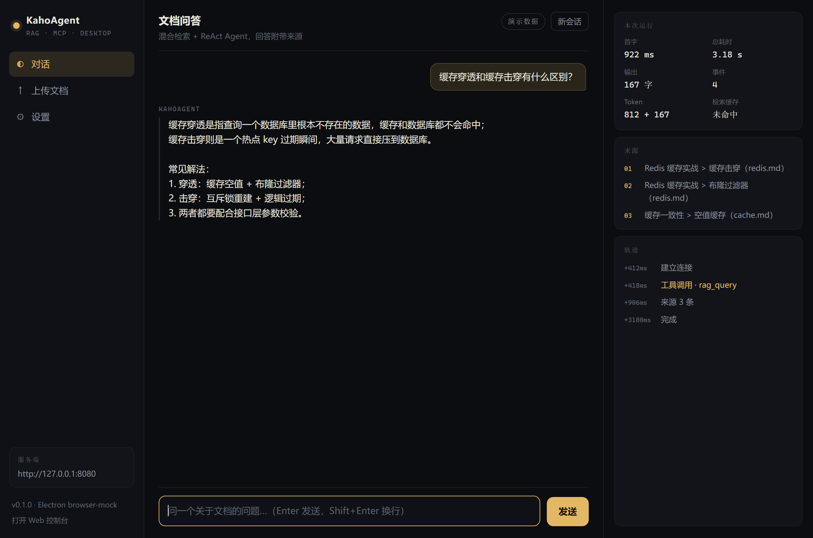

# KahoAgent Desktop

KahoAgent 的 Electron 桌面客户端。与 Web 控制台共用同一套服务端接口，
额外提供原生窗口、文件选择上传与本地配置。



> 上图是渲染层的实际截图（`?demo=1` 演示数据）。在仓库内查看：
> [`docs/desktop.png`](../docs/desktop.png)。

## 运行

```bash
cd desktop
npm install        # 首次；会下载 Electron（约 100MB）
npm start          # 需要服务端已启动（默认 http://127.0.0.1:8080）
```

启动前先跑服务端：

```bash
cd ..
go run ./cmd/server     # HTTP + Web 控制台
go run ./cmd/worker     # 异步入库（上传文档时需要）
```

## 功能

| 能力 | 说明 |
|---|---|
| 流式对话 | 主进程读 SSE，逐事件经 IPC 推给渲染进程 |
| 来源面板 | `sources` 事件 → 可追溯的片段来源 |
| 运行轨迹 | 工具调用、来源、完成，带相对时间戳 |
| 用量统计 | 首字 / 总耗时（本地实测），Token / 缓存命中（服务端 `stats` 事件） |
| 上传文档 | 原生文件对话框 → `POST /api/upload` |
| 服务器地址 | 设置里可改，持久化在 `userData/config.json` |

## 安全边界

- `contextIsolation: true`、`nodeIntegration: false`、`sandbox: true`
- preload 只暴露 9 个窄接口，不暴露 `ipcRenderer`
- 网络请求全部在主进程（渲染进程 `connect-src 'none'`），
  既避开 CORS，也避免页面脚本直接访问任意地址
- 服务器地址只接受 `http/https`；`shell.openExternal` 同样限制协议
- 渲染层所有模型/文档文本走 `textContent`，不拼 `innerHTML`

## 目录

```
desktop/
├── main.js              # 主进程：窗口、IPC、SSE、上传、配置
├── preload.js           # contextBridge 窄接口
├── renderer/
│   ├── index.html
│   ├── styles.css
│   └── app.js           # 渲染层；无 window.kaho 时自动降级为 mock（便于浏览器预览）
└── package.json
```

## 已知限制

- **在无交互桌面的会话里无法创建窗口**：本仓库的 CI/agent 环境里
  `electron --version` 正常，但创建 `BrowserWindow` 时进程直接崩溃
  （segfault，需要 `--no-sandbox` 才能越过初始化）。上面的截图是用
  同一份渲染层在 Chrome 里渲染的，**不是** Electron 窗口截图。
  正常桌面环境 `npm start` 可用；若发行版有 sandbox 限制，用
  `electron . --no-sandbox`。
- 没有做打包（electron-builder）；需要分发时再补。
- 不做本地缓存/离线；服务端不可用时只提示错误。
