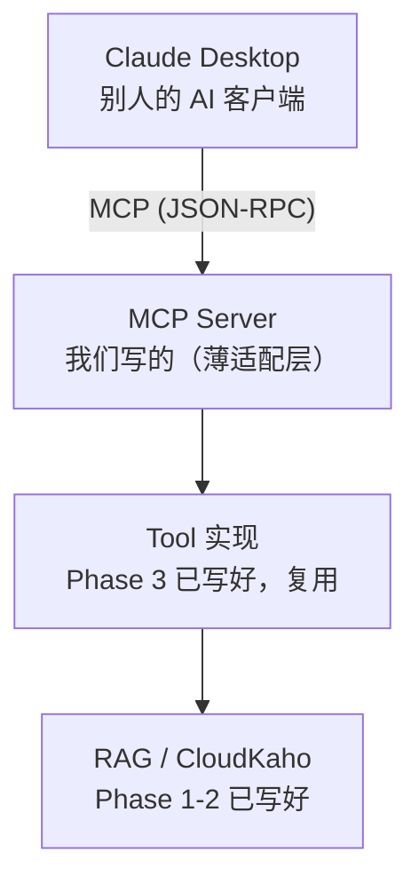

# KahoAgent 完整学习清单

> 这份清单把散落在各处的学习内容合并成一份：
> `IMPLEMENTATION.md` 的 6 个「📚 本阶段学习内容」（开工前排的计划）、
> `spike-evidence/` 各阶段的实测结论、`eval-results.md` 的排查过程、
> `optimization.md` 的 pprof 数据，以及容器化阶段踩的坑。
>
> **阅读方式**：每个条目分两层 ——
> 「📖 计划里学的」是当初的认知，「🔬 实测修正」是做完之后知道的。
> 两者不一致的地方我用 ⚠️ 标出来了，**那些才是这个项目真正教会我的东西**。
> 如果只想看结论，直接搜 ⚠️。

## 目录

| 阶段 | 主题 | 条目 |
|---|---|---|
| [Phase 0](#phase-0基础认知) | 基础认知 | L0.1 RAG · L0.2 Embedding · L0.3 Milvus · L0.4 MCP · L0.5 Eino |
| [Phase 1](#phase-1文档处理-pipeline) | 文档处理 | L1.1 分块（+字节/字符坑、SDK 伪造错误）· L1.2 幂等 · L1.3 Embedding API · L1.4 Kafka（+共享缓存坑）· **L1.5 归因错误** |
| [Phase 2](#phase-2混合检索与融合) | 混合检索 | L2.1 单路不够 · L2.2 BM25 · **L2.3 RRF 反噬** · L2.4 评估指标 · L2.5 ReRank · **L2.6 量纲不一致** · **L2.7 temperature=0** · L2.8 降级与缓存 · L2.9 Golden set |
| [Phase 3](#phase-3agent-编排) | Agent 编排 | L3.1 ReAct · L3.2 Tool Description · **L3.3 上下文管理** · L3.4 SSE |
| [Phase 4](#phase-4mcp-协议暴露) | MCP 暴露 | L4.1 架构位置 · L4.2 安全模型（+并发测试自欺欺人） |
| [Phase 5](#phase-5可观测性与压测) | 可观测性 | L5.1 Prometheus · L5.2 pprof · **压测归因** |
| [Phase 6](#phase-6容器化与部署) | 容器化 | L6.1 cgo 四个坑 · L6.2 CI 边界 |
| [跨阶段](#跨阶段方法论) | 方法论 | 排查方法 · 测试有效性 · 数字诚实 · 范围控制 |
| [附录](#附假设被推翻清单) | 索引 | 假设被推翻清单 · 自查清单 · 铁律 · 数字索引 |

**加粗的是计划假设被实测推翻的地方 —— 优先读这些。**

---

# Phase 0：基础认知

## L0.1 RAG 到底在解决什么问题

📖 **计划里学的**

LLM 两个硬伤：知识截止日期、不知道你的私有数据。微调成本高且更新慢，
所以业界解法是把相关资料塞进 prompt 让模型现读现答。

```
用户问题 → [检索] 从知识库找出最相关的几段文字
         → [增强] 把这几段拼进 prompt
         → [生成] LLM 基于这些材料回答
```

**核心认知**：RAG 系统 90% 的效果取决于「检索」这一步。检索不准，
再强的模型也是垃圾进垃圾出。所以本项目 Phase 1-2 全部在打磨检索，
Phase 3 才碰生成。

**自测**：为什么不能把整个文档丢给 LLM？
→ 上下文窗口有限 + 成本 + 长文本中间信息会被忽略（lost-in-the-middle）

🔬 **实测修正**

「90% 取决于检索」这个判断在实测里得到了印证，而且比预想的更极端：
`hybrid-rrf` 的 MRR 是 0.698，加了精排变 0.798 —— **同一个生成模型，
只因为喂进去的材料排序变了，效果差 14%**。

- 资源：[吴恩达 Building & Evaluating Advanced RAG](https://www.deeplearning.ai/short-courses/building-evaluating-advanced-rag/)（免费，看前 3 节）

## L0.2 Embedding 与向量检索

📖 **计划里学的**

- **Embedding**：把文本映射成高维向量（本项目 1024 维），语义相近的向量距离也近
- **余弦相似度**：衡量向量方向接近程度，值域 [-1, 1]
- **为什么用余弦不用欧氏距离**：文本向量的「长度」不携带语义信息，只有方向重要
- **必须理解的坑**：Embedding 模型有最大输入长度（512-8192 token），
  超长文本必须先分块 —— 这就是 Chunker 存在的原因

**自测**：为什么「把一整本书 embed 成一个向量」是错的？
→ 语义被平均掉了，检索时什么都匹配不上

⚠️ 🔬 **实测修正：embedding 有它根本分不开的东西**

计划里把向量检索当成「语义万能」，实测发现它有**系统性盲区**：

77 条 golden set 里，向量路 RR = 0.000（前五全错）而 BM25 = 1.000 的
极端案例有 3 条，**全部是 `confusable` 类** —— 「缓存击穿」vs「缓存雪崩」
这种共享大部分语义、仅靠一两个词区分的概念，embedding 分不开。

这不是模型不够好，是**把文本压成单个向量必然丢失的信息**。
所以 BM25 那一路不是「补充」，而是对这类查询的**唯一解**。

分类型 MRR 实测（`vector-only`）：

| 类型 | MRR | 说明 |
|---|---|---|
| keyword | 0.821 | 专有名词，意外地不差 |
| semantic | 0.540 | 口语提问，本该是强项 |
| confusable | **0.250** | 近义概念，几乎失效 |

## L0.3 Milvus 基本概念

📖 **计划里学的**

| 概念 | 类比关系型数据库 | 说明 |
|------|-----------------|------|
| Collection | Table | 一组同 schema 的向量 |
| Field | Column | 字段，必须有一个 VectorField |
| Index | Index | 决定检索速度与精度 |
| Partition | 分区表 | 本项目不用 |

**HNSW 索引**（Hierarchical Navigable Small World，图索引）：
- `M`：每个节点连接数，越大越准但内存越高（用 16）
- `efConstruction`：建索引时搜索宽度，越大质量越好但越慢（用 200）
- `ef`（搜索时）：越大越准越慢，**必须 ≥ topK**（用 64）

**两个必踩的坑**：
1. `Insert` 之后不 `Flush()`，数据还在内存 buffer 里，搜不到
2. 搜索前必须 `LoadCollection()` 把索引加载进内存，否则报错

🔬 **实测修正**

这两个坑确实踩了，而且症状极具误导性 —— 不报错，就是**搜不到结果**，
很容易误判成「向量算错了」或「相似度阈值太高」。
判断方法：先用 `Query`（按 ID 精确查）确认数据在不在，
再排查检索逻辑。**把「有没有数据」和「排序对不对」分开验证**，
这个思路后来在 Phase 2 排查 RRF 时又用了一次。

- 资源：[Milvus Quickstart](https://milvus.io/docs/quickstart.md)

## L0.4 MCP 协议

📖 **计划里学的**

MCP 是 AI 客户端（Claude Desktop / Cursor）调用外部工具的标准协议，
相当于 AI 世界的 USB-C。

**三种原语**：

| 原语 | 作用 | 本项目 |
|------|------|-----------|
| **Tools** | 模型可主动调用的函数 | ✅ 只用这个 |
| Resources | 模型可读取的数据源 | ❌ |
| Prompts | 预定义提示词模板 | ❌ |

**通信**：JSON-RPC 2.0，两种传输层 —— `stdio`（本地进程，Claude Desktop 用）
和 Streamable HTTP（远程）。

**⚠️ 最致命的坑**：stdio 模式下 **stdout 是协议通道**。
`fmt.Println("debug")` 一行就能让整个协议崩掉。**所有日志必须走 stderr**。

🔬 **实测修正**

这个坑计划里就警告了，实测确实是对的，而且**验收必须专门测它** ——
因为日志污染 stdout 的表现是「客户端连不上」，而不是任何明确报错。
Phase 4 的验收项之一就是「审计日志不破坏 stdout」，实测通过。

补充一个计划里没提的：`tools/list` 返回的工具数会随配置变化。
未配 `CLOUDKAHO_TOKEN` 时只暴露 1 个工具（`rag_query`），
这是预期降级，但看起来像握手失败。

- 资源：[MCP 官方介绍](https://modelcontextprotocol.io/introduction) · [Go SDK Quick Start](https://go.sdk.modelcontextprotocol.io/quick_start/)

## L0.5 Eino 框架的四个核心抽象

📖 **计划里学的**

| 抽象 | 是什么 | 本项目 |
|------|--------|-----------|
| **ChatModel** | 大模型对话接口 | Phase 3 |
| **Tool** | 模型可调用的工具 | Phase 3 |
| **Retriever** | 检索器 | Phase 2 自己实现这个接口 |
| **Graph / Chain** | 编排 | Phase 3 用 ADK 的 ReAct |

**为什么选 Eino 而不是自己撸**：ReAct 循环的状态管理、流式处理、
错误重试非常繁琐，`adk` 包封装好了。但**不盲用** —— 检索器自己实现，
只让它满足 Eino 接口，既有掌控力又能接进生态。

⚠️ 🔬 **实测修正：框架的错误处理策略必须自己确认**

eino 在工具返回 error 时会**中止整个节点**（`compose/tool_node.go:1203`），
而不是把错误交给模型让它换个方式重试。

后果：一个工具失败（比如 CloudKaho 超时），整轮对话直接失败，
用户看到的是错误页而不是「这部分查不到，但我可以回答别的」。

解法是在工具内部把错误转成**正常返回的文字**（"查询失败：xxx"），
让模型自己决定怎么处理。这是「优雅降级」的实现基础 ——
Phase 3 验收项之一就是「工具失败时优雅降级」。

**教训**：用框架前必须搞清它在**异常路径**上的行为，
正常路径谁都能跑通。

- 资源：[eino-examples/quickstart](https://github.com/cloudwego/eino-examples/tree/main/quickstart)

---

# Phase 1：文档处理 Pipeline

## L1.1 分块策略

📖 **计划里学的**

块切得不好，检索到的内容要么缺上下文（太碎），要么混入无关信息（太大）。

| 策略 | 做法 | 优点 | 缺点 | 本项目 |
|------|------|------|------|--------|
| **固定长度** | 每 N 字符切一刀 | 简单均匀 | 可能切断句子 | ✅ baseline |
| **固定长度 + overlap** | 相邻块重叠 M 字符 | 缓解切断 | 存储冗余 | ✅ baseline 标配 |
| 递归字符分割 | 按 `\n\n`→`\n`→`。` 递归切 | 保持语义 | 大小不均 | ⏸️ 可选 |
| **结构化分割** | 按 Markdown 标题切 | 语义边界最准 | 仅适用结构化文档 | ✅ 主力 |
| 语义分割 | 算相邻句 embedding 相似度，在转折处切 | 效果最好 | 每句都要 embed | ❌ |

**overlap 的作用**：假设块边界正好切在「布隆过滤器可以解决缓存穿透」中间，
前块结尾「布隆过滤器可以」，后块开头「解决缓存穿透」，两块单独看都不完整。
overlap 让后块包含前块结尾，保证语义完整。

**自测**：按标题切 vs 按 500 字切，检索「Redis 主从复制怎么配置」
哪个更可能命中？为什么？

🔬 **实测修正**

⚠️ **中文必须用 `[]rune` 而不是 `[]byte` 切分。**
用 `[]byte` 会把一个汉字（UTF-8 里 3 字节）切成两半，产生乱码。

保留 `heading_path`（如 `Redis 八股总集 > 三、缓存穿透 > 1. 定义`）
比预想的更有价值 —— 它既是给 LLM 的上下文，也是回答里「出处」的来源。
实测 MCP 返回的引用长这样：

```
【片段 2】来源: 面试笔记：缓存穿透、击穿、雪崩怎么区分和解决
         > 知识点总结（2026-6-13-interview-redis-cache-problems.md）
```

## L1.1 附：Milvus 的 `max_length` 单位是**字节**不是字符

这个坑值得单列，因为它**只在中文场景炸**。

建表写 `WithMaxLength(8192)`，按「8192 个字符」理解，截断函数也按 rune 截。
结果服务端仍然拒收：

```
length of varchar field content exceeds max length,
length: 24576, max length: 8192
```

**8192 汉字 × 3 字节 = 24576** —— 和报错数字精确对应。

⚠️ **纯 ASCII 文档永远不会触发这个 bug。** 它恰好只在中文知识库
（本项目的主场景）炸，这正是它危险的地方。

**修复三步**：
1. 常量改名带上单位：`maxContentLen` → `maxContentBytes`
   —— 让误读在**语法层面**无法发生
2. 按字节截断，但要回退到 rune 边界避免切出非法 UTF-8：
   `for cut > 0 && !utf8.RuneStart(s[cut]) { cut-- }`
3. 上限提到 32768 字节（默认 chunk 500 字符 ≈ 1500 字节，留足余量）

⚠️ **顺带修正一个设计问题：内容可以截断，ID 绝对不能。**
内容截断是可接受降级（丢尾部文本）；ID 截断会让两个不同 chunk 撞同一主键，
**后写的静默覆盖先写的** —— 表现为「数据莫名其妙少了」，
比直接报错难查一个数量级。所以 ID 超长改为**直接报错**。

## L1.1 附：Milvus SDK 在零命中时返回**伪造的**错误

对空 collection 检索，SDK 报的是：

```
extra output fields [id doc_id chunk_index content metadata] found
and result does not dynamic field
```

**这个错误信息和真实原因（没有命中）毫无关系。**

读 SDK 源码 `client/data.go:198` 才定位到：命中数为 0 时服务端不返回任何
`fieldsData`，SDK 的 `outputSet` 一个都消不掉，于是误入了这个分支。

**修复：判空必须在判错之前，顺序不能反。**

```go
if r.ResultCount == 0 { return nil, nil }
if r.Err != nil { return nil, fmt.Errorf("search result: %w", r.Err) }
```

**为什么必须当期解决**：空结果不是异常，是**正常路径** ——
新部署空库、加标量过滤后过滤掉全部候选、用户查库里没有的话题。
留到 Phase 3 会表现为「Agent 偶发报一个看不懂的错」，
而那时调用链已深到难以定位。

**教训**：不要假设第三方 SDK 的错误信息指向真实原因。对不上就去读源码。

## L1.2 幂等性设计

📖 **计划里学的**

**问题**：同一个文件上传两次，会不会在 Milvus 里存两份？

**解法**：让 Chunk ID 可复现 —— `ID = sha256(DocID + "#" + Index)`。
第二次上传时同样的输入产生同样的 ID，`Upsert` 会覆盖而非新增。

**为什么不用自增 ID 或 UUID**：那样每次上传都是新记录，
重复数据会污染检索结果。

**面试点**：这是「幂等」在数据管道中的应用，类比 HTTP 的 PUT vs POST。

⚠️ 🔬 **实测修正：幂等的前提是 DocID 本身稳定**

`DocID` 早期版本用纯 `basename` 生成，结果 `en/getting-started.md` 和
`ja/getting-started.md` 互相覆盖。修复后改用相对路径
（`tools-getting-started`），但**旧的无前缀 ID 变成了孤儿数据** ——
内容已被新记录取代，留着只会在检索时产生重复结果。

实测清理掉 **346 行**孤儿数据（12 个旧 docID）。

**教训**：幂等设计保证「同一个 key 不重复」，但**不保证 key 的生成规则不变**。
key 的规则一改，历史数据就成了孤儿，而且不会有任何报错 ——
只会让检索结果悄悄变差。改 ID 生成规则时必须同时想好历史数据怎么办。

## L1.3 Embedding API 的工程问题

📖 **计划里学的**

| 问题 | 后果 | 解法 |
|------|------|------|
| 一条条调用 | 100 chunk = 100 次 HTTP | **批量调用**（OpenAI 最多 2048 条） |
| 无重试 | 网络抖动整个任务失败 | 指数退避（1s→2s→4s，最多 3 次） |
| 无限流 | 触发 rate limit 被封 | 令牌桶 |
| 超长文本 | API 报错 | 入库前校验 token 数 |

**要求**：批量 + 重试必做，限流看情况（个人项目 QPS 低）。

⚠️ 🔬 **实测修正：限流不是「看情况」，是必做**

计划里判断「个人项目 QPS 低，限流看情况」——**这个判断错了**。

Phase 5 压测实测：20 req/s 时 **187 次失败全部是上游
`HTTP 429 Throttling.Concurrency`**。DashScope 账号的并发配额
比想象的低得多，而且触发时不是变慢，是直接失败。

**教训**：「个人项目量小」这个假设在**上游有配额**时不成立 ——
瓶颈不在你的流量绝对值，在于你和配额的相对关系。

## L1.4 Kafka 的作用与关键概念

📖 **计划里学的**

**为什么要 Kafka**：文档向量化很慢（10 页 PDF 可能 30 秒）。
同步处理会让 HTTP 请求挂 30 秒。用 Kafka 解耦：上传立即返回，
后台 worker 慢慢处理。

| 概念 | 说明 | 本项目 |
|------|------|--------|
| Topic | 消息分类 | `document-processing` |
| Partition | 并行单元，一个 partition 只能被同组内一个 consumer 消费 | 3 个 |
| Consumer Group | 一组 consumer 协作消费 | `kahoagent-worker` |
| Offset | 消费位置 | 手动提交 |

**⚠️ 关键坑**：`ReadMessage` 会自动提交 offset，处理失败消息就丢了。
必须用 `FetchMessage` + 成功后 `CommitMessages`，这叫「至少一次」语义。

**自测**：为什么「先同步跑通，最后才上 Kafka」？
→ 异步会让调试变难，出错时不知道是业务逻辑错了还是消息没消费到。
先证明业务逻辑对，再加异步层。

🔬 **实测修正**

「先同步后异步」这个顺序实测非常正确，值得作为通用原则：
**任何时候都不要同时引入两个可能出错的新东西**。

⚠️ 🔬 **实测修正 2：这条管道最终没有接入生产链路**

上面「上传接口收到文件立即返回，后台 worker 慢慢处理」的场景
**没有实现**。2026-09-04 审查确认：

| 计划 | 实际 |
|---|---|
| HTTP 上传接口 | **不存在**。路由只有 `/api/chat`、`/healthz`、`/metrics`、`/debug/pprof/*` |
| 后台 worker 进程 | **不存在**。`cmd/` 下只有 `server` 和 `mcp` |
| producer/consumer 被谁调用 | **没有调用方**。全仓库 import `internal/pipeline` 的只有 `scripts/eval/ingest_check.go`，且只用 `NewIngester`（分块+向量化那段） |
| Kafka 收发的验证 | 只有 `//go:build integration` 的集成测试，默认不跑 |

代码本身是完整且正确的（至少一次语义、失败重投递、900KB 上限），
缺的是**真实的上传场景**——语料入库是手工跑一次的离线动作，
没有东西需要解耦。

**这不是失败，是一个有价值的发现。** 三周后做 PDF 支持时，
正是「入库不在生产请求路径上」这个事实（`Dockerfile` 只编两个二进制、
`ingest_corpus` 带 `//go:build corpus`、`grep internal/pipeline` 生产代码
零引用）让我否决了「把 PDF 解析器编进 Go 二进制」的方案 ——
既然是离线动作，用 Python 调 MinerU 就行。见 `pdf-plan-b.md` §1。

**通用教训：写方案前先确认约束是真约束，还是自己假设的约束。**
「文档处理必须异步」在有上传接口的产品里是真的，
在这个项目里不是 —— 而我按前者的假设写了一整个 Phase 的管道。

## L1.4 附：kafka-go 的 `DefaultTransport` 是**包级共享缓存**

**现象**：3 个 Kafka 集成测试**单独跑全过，一起跑后两个必挂**，
报 `[3] Unknown Topic Or Partition` —— 而日志明确显示
`CreateTopics err=<nil>`，topic 确实创建成功了。

**排查过程（前两个假设都错，这个顺序本身是记录的价值）**：

| # | 假设 | 做法 | 结果 |
|---|---|---|---|
| 1 | topic 创建是异步的 | 加 `waitForTopic` 用 `conn.ReadPartitions` 轮询 | ❌ 无效 |
| 2 | 上个测试的 `DeleteTopics` 干扰元数据 | 去掉 cleanup 里的删除 | ❌ 无效 |
| 3 | 失败的永远是「第一个之后」的 → 存在跨测试共享状态 | 翻源码 | ✅ 找到 |

**根因**：`transport.go:126` —— `kafka.Writer` 未指定 `Transport` 时
用包级全局 `DefaultTransport`，其 `metadataTTL()` 默认 **6 秒**元数据缓存。

| 时刻 | 事件 |
|---|---|
| T0 | 测试 1 建 topic A，写入 → 缓存冷，拉元数据，成功 |
| T0+2s | 测试 2 建 topic B，用**独立 Conn** 确认 B 已就绪 ✅ |
| T0+2s | 测试 2 写入 B → transport 用 T0 的缓存，**里面没有 B** → 报错 |

⚠️ **核心机制：验证用的连接和实际写入用的连接，看到的不是同一份元数据。**
`conn.ReadPartitions` 查得再准也没用 —— 那是另一条代码路径。

**两条教训**：
1. **「单独跑过、一起跑挂」几乎必然是共享状态。**
   不要在「等待逻辑不够久」上反复加时间 —— 那是治标。
2. **验证要走和实际操作相同的代码路径。**

**生产影响**：线上若动态创建 topic（如按租户分 topic），
创建后立刻写入同样会撞这 6 秒缓存。本项目 topic 固定，不受影响 —— 但记录在案。

## L1.5 最重要的一课：Phase 1 自己的结论后来被推翻了

**这是整个项目里「假设被推翻」力度最强的一条 —— 因为推翻的是我自己的阶段性结论。**

**Phase 1 当时观察到**：查询「怎么防止缓存被恶意请求打穿」，
Top1 返回的是**缓存击穿**（score 0.7096），而正确答案是**缓存穿透**。

**当时的归因**：「纯向量检索无法区分穿透/击穿/雪崩这类近义概念」，
并把它作为引入 BM25 + RRF + 精排的**实证依据**写进了文档。

**Phase 2 复查同一条查询**（`scripts/eval/backlog_check.go`）：

| 策略 | Top1 |
|---|---|
| vector-only | ✅ **正确** |
| bm25-only | ❌ 无关 |
| hybrid-rrf | ✅ 正确 |
| hybrid+rerank | ✅ 正确 |

**纯向量检索自己就答对了。**

**真实根因：变量不是检索算法，是语料。**
Phase 1 时库里只有 `docs/sample.md` 一篇，里面根本没有真正讲
「缓存穿透」解法的段落 —— 向量检索只能在现有内容里挑最接近的。
Phase 2 灌入 77 篇真实文章（1307 chunk）后，正确的块进了库，
向量路自己就排对了。

⚠️ **误判类型：召回覆盖问题被误读成了排序能力问题。**

**教训（这条值得单独记住）**：
> **在语料不完整时观察到的检索错误，不能归因于检索算法。**
> 要先确认「正确答案在库里」，再谈「排没排出来」。

这正是 Phase 2 用 recall@50 做分层定位的直接原因 —— 那个方法就是从这次教训来的。

**诚实注记**：这不影响引入 BM25 + RRF + 精排的**决策**
（近义混淆在更大的 golden set 上确有其事，`confusable` 类 vector-only
MRR 仅 0.250）。但**这个具体案例不构成那个结论的证据**，
当时拿它做论据是不严谨的。

---

# Phase 2：混合检索与融合

> 这一阶段是整个项目学到最多的地方 —— 因为计划里的核心假设被实测推翻了。

## L2.1 为什么单靠向量检索不够

📖 **计划里学的**

| 检索方式 | 擅长 | 不擅长 |
|---------|------|--------|
| **向量（Dense）** | 语义相似 | 精确匹配（搜「RedisJSON」返回一堆讲 Redis 的） |
| **BM25（Sparse）** | 关键词精确匹配 | 同义词（搜「登录」匹配不到「认证」） |

**结论**：两者互补，所以要混合。这是工业界 RAG 的标配。

**面试点**：为什么不训练更好的 embedding 模型同时解决两个问题？
→ 成本极高且收益不确定，混合检索是性价比最优解。

🔬 **实测修正**

「互补」的方向判断对了，但**强弱关系判断错了**。

实测三类查询的 MRR：

| 类型 | vector | bm25 | 计划预期 |
|---|---|---|---|
| confusable | 0.250 | **0.625** | 没预期 |
| semantic | 0.540 | 0.543 | **向量应占优** ❌ 打平 |
| keyword | 0.821 | 0.856 | **BM25 应占优** ✅ |

⚠️ `semantic` 类（口语提问，与原文用词不同）本该是向量检索的主场，
实测**和 BM25 打平**。这说明中文技术文档里，口语提问和原文的
**词汇重叠度比预想的高** —— 用户问「缓存穿透怎么解决」，
文档里就写着「缓存穿透」，BM25 直接命中。

**教训**：「哪一路更强」不能靠推理，必须分类型实测。
而分类型评估的价值就在这里 —— 只看总分会完全看不到这一点。

## L2.2 BM25 原理

📖 **计划里学的**

BM25 是改进版 TF-IDF：
- **TF（词频）**：出现越多越相关，但有**饱和上限**（100 次不比 10 次相关 10 倍）
- **IDF（逆文档频率）**：越罕见越有区分度（「的」没区分度，「布隆过滤器」有）
- **文档长度归一化**：长文档天然含更多词，要惩罚

**PostgreSQL 实现**：

```sql
SELECT id, ts_rank(content_tsv, query) AS score
FROM chunks, to_tsquery('simple', 'redis & 缓存') query
WHERE content_tsv @@ query
ORDER BY score DESC LIMIT 20;
```

**⚠️ 中文的坑**：PG 默认分词器不支持中文，「Redis缓存穿透」被当成一个词。
两种解法：装 `pg_jieba` 扩展（效果好但要编译安装），
或入库时在 Go 侧用 `gojieba` 分词存成空格分隔（**本项目用这个，
避免 Docker 镜像折腾**）。

⚠️ 🔬 **实测修正：那句「避免 Docker 镜像折腾」完全说反了**

选 gojieba 正是为了**避开** Docker 麻烦，结果它是 cgo 库，
反而制造了整个项目最集中的容器化麻烦（见 [L6.1](#l61-cgo-项目容器化)）：
g++ 缺失、libstdc++ 缺失、词典路径指向编译机，
外加镜像体积从目标 30MB 涨到 110MB。

**教训**：评估依赖时，「避免了什么麻烦」和「引入了什么麻烦」要一起算。
`pg_jieba` 要编译 PG 插件（一次性的构建期成本），
gojieba 引入 cgo（**永久的、影响所有构建产物的**成本）。
当时只看到前者的成本，没看到后者。

另一个实测细节：用 `CutForSearch`（搜索引擎模式）而非 `Cut` ——
它会在长词基础上额外切子串，「布隆过滤器」→ `[布隆 过滤 滤器 过滤器]`，
查「过滤器」也能命中。tsquery 用 `|`（OR）而非 `&`（AND）连接：
查询切出 6 个词若要求全部命中，召回率趋近于 0。

## L2.3 RRF 融合算法

📖 **计划里学的**

**问题**：向量检索和 BM25 的分数量纲完全不同
（余弦 0~1，BM25 0~几十），不能直接相加。

**RRF 的巧妙之处**：**只用排名，不用分数**。

```
score(d) = Σ  1 / (k + rank_i(d))
          i∈检索器
```

`k` = 60（论文推荐值）。

**为什么有效**：
- 排名第 1 得 1/61 ≈ 0.0164，第 10 得 1/70 ≈ 0.0143 → 容忍排序噪声
- 两路都靠前的文档累加后明显更高 → **双重印证的结果被提升**

**举例**：

```
向量检索: [A, B, C]     BM25: [C, A, D]
A: 1/61 + 1/62 = 0.0325  ← 两边都靠前，最高
C: 1/63 + 1/61 = 0.0323
B: 1/62        = 0.0161
D: 1/63        = 0.0159
```

## 实测修正：RRF 融合后 MRR 反而**低于**纯 BM25

这是整个项目最重要的一课。计划里 L2.3 讲的是「融合取长补短」，
实测结果直接相反：

| Method | MRR |
|---|---|
| `bm25-only` | **0.714** |
| `hybrid-rrf` | 0.698 ← 融合之后**更差** |

### 排查过程（这个方法比结论更有价值）

**第一步：分清「找不到」还是「排不对」。**

看 recall@50（只看候选池里有没有，不看顺序）：

| 路径 | recall@50 |
|---|---|
| vector | 0.707 |
| bm25 | 0.740 |

两路接近 → **都能找到**，问题纯粹在排序。
这一步一次性排除了「向量索引建错」「分词有问题」「数据没入库」一整类猜想。

**第二步：定位到 RRF 的机制本身。**

RRF 只用排名不用分数，**丢掉了强度信息**：

| 情况 | 得分 |
|---|---|
| 被 BM25 排第 1，但不在向量的 50 条里 | 1/61 = **0.0164** |
| 被两路都排第 10 | 1/70 + 1/70 = **0.0286** |

**单路强命中输给了双路平庸。**

RRF 隐含假设「两路都认可 = 更可信」。该假设在两路质量相当时成立，
**质量悬殊时弱路就有权否决强路**。

逐查询验证：77 条里 11 条 hybrid 输给 bm25，其中 8 条（73%）
是向量路 RR 低于 BM25。最极端 3 条向量路 RR = 0.000 而 BM25 = 1.000，
全部是 `confusable` 类。

**第三步：加权 RRF 为什么不是解法。**

扫描 9 组权重后发现，三类查询的最优权重**互相矛盾**：

| 查询类型 | 最优 vector:bm25 | 该点 MRR |
|---|---|---|
| confusable | 0.0:1.0 | 0.625 |
| semantic | 1.0:0.3 | 0.638 |
| keyword | 0.7:1.0 | 0.876 |

总 MRR 在 `0.0:1.0` 取到最大，**只是因为 keyword 类占 40/77**，
样本量最大的一类主导了平均值 —— 这个「最优」不是任何一类的最优解。
而查询进来时并不知道它属于哪一类，所以**静态全局权重是死路**。

### 正解：精排提供「新的判据」

既然 recall@50 已有 0.70+，正确答案本就在候选池里，
缺的是**新的判据** —— 把 RRF 的 top-20 交给 LLM 直接读内容判断相关性。

实测 `hybrid-rrf+rerank` MRR **0.798**，反超 `bm25-only` 的 0.714（+11.8%）。

> 本节的数字是 2026-08-20 那轮的观测值，保留原样以对应当时的推理过程。
> 2026-09-04 重跑后是 0.818 vs 0.723（+13.2%），结论与量级完全一致 ——
> 变更内容见 `eval-rerun-2026-09-04.md`，最新数字以 `eval-results.md` 为准。

### 这一课的通用教训

1. **论文推荐值不等于你的场景适用。** RRF 的 k=60 和「排名融合」思路
   在两路质量相当时成立，前提不满足就会反向优化。
2. **融合不是「取长补短」的自动保证**，它有自己的隐含假设。
   用之前先问：我这两路质量差多少？
3. **分类型评估能看到总分看不到的东西。** 如果只看总 MRR，
   会以为「加权能救」；分类型一看就知道最优权重互相矛盾。
4. **排查要先切「哪一层的问题」。** recall@50 那一步是整个排查的关键 ——
   它把「召回层」和「排序层」分开，一次排除了一半的可能性。

## L2.4 评估指标

📖 **计划里学的**

| 指标 | 公式 | 含义 | 何时用 |
|------|------|------|-----------|
| **Recall@K** | 前 K 个中相关文档数 / 全部相关文档数 | 该找的找到了多少 | 关心覆盖率 |
| **MRR** | 第一个正确结果排名的倒数，对所有 query 取平均 | 正确答案排得多靠前 | 关心首位准确性 |
| NDCG@K | 考虑排序位置的加权得分 | 最全面但复杂 | 本项目不做 |

**MRR 举例**：

```
Query1: 正确答案排第 1 → RR = 1/1 = 1.0
Query2: 正确答案排第 3 → RR = 1/3 = 0.33
Query3: 前 10 都没有   → RR = 0
MRR = (1.0 + 0.33 + 0) / 3 = 0.44
```

**为什么 RAG 场景 MRR 比 Recall 更重要**：LLM 通常只看 top 3-5 个块，
排第 20 的正确答案等于没有。

⚠️ 🔬 **实测修正：绝对值的适用范围**

**Recall@5 只有 0.444，不是因为系统差，是因为分母诚实。**

分母是**该查询的全部相关块**（`internal/eval/metrics.go:39`），
而 golden set 平均每条查询有 **8.18 个**相关块（78 条查询 / 638 条标注，
中位数 9，最多 18，只有 2 条是单相关块）—— 前 5 个位置根本装不下。

```
Recall@5 理论上界 = mean(min(5, n) / n) = 0.667
实测 0.441 / 上界 0.667 = 66%
```

> 早期这里写的是「golden set 按『一条查询只有一个正确答案块』标注」，
> **那是错的** —— 2026-09-04 实算 golden set 才发现平均 8.18 个。
> 说法本身还把结论引向了反面：真按单块标注的话 Recall 上界就是 1.0，
> 0.444 反倒说明系统差。教训是**引用自己项目的数据前先算一遍**。

不少项目用 hit rate（top-5 里命中 ≥1 就记 1.0）冒充 Recall，
同样的检索结果在那个定义下能报到 0.9 以上。这个绝对值适合
**策略间对比**（同一把尺子量四种方案），跨项目比较则必须先对齐定义。

⚠️ **MRR 与 Recall 不共享分母，别放在一起做上下界推断。**

见过一种错误推理：「Recall@5 上界才 0.667，MRR 0.818 数学上不可能」。
两者分母完全不同 ——

| 指标 | 分母 | 代码 |
|---|---|---|
| Recall@5 | 该查询的相关块**总数** | `metrics.go:39` |
| MRR | 首个命中的**位次** | `metrics.go:53` |

某查询有 12 个相关块、检索器把其中 1 个排在第 1 位：
Recall@5 = 1/12 = 0.083，RR = 1/1 = 1.000。同一次检索一个极低一个满分，
不矛盾 —— **MRR 与相关块总数无关**。

⚠️ **别把 MRR 换算成「平均排名」。** `1/MRR = 1/0.798 = 1.25`，
但这是**调和平均**不是算术平均，而且没命中的查询记 0 也拉低了它。
说成「正确答案平均排在第 1.25 位」是错的 ——
这种「换算完更好听」的说法最容易在追问下崩掉。

⚠️ **小样本列只能看趋势。** `confusable` 只有 8 条，
单条查询对错就值 0.125。实测清理数据后这一列从 0.629 变到 0.546，
看着像退化 0.083，实际是**不到一条查询的摆动**（且精排走 LLM 非确定输出）。
报告这种数字必须同时给样本量。

## L2.5 ReRank 的作用

📖 **计划里学的**

**流程**：召回 50 条（快但粗）→ 精排取前 5（慢但准）

**为什么两阶段**：直接精排 10 万条太慢；只用向量取 top5 又不够准。

| 方式 | 原理 | 成本 | 本项目 |
|------|------|------|--------|
| Cross-Encoder | query 和 doc 拼一起过模型 | 需部署模型 | ❌ |
| **LLM pointwise** | 让 LLM 给每个候选打 0-10 分 | 一次 API 调用 | ✅ |

🔬 **实测修正**

精排的代价比预想的大得多：

| Method | P50 | P99 |
|---|---|---|
| `hybrid-rrf` | 149ms | 253ms |
| `hybrid-rrf+rerank` | **1.514s** | **2.299s** |

**延迟涨了 10 倍**换来 MRR +14%。这个取舍在「检索质量决定一切」的
RAG 场景是值得的，但**必须知道自己付了什么代价** ——
也正因为 P99 到了 2.3s，Prometheus 的 Histogram 桶边界才必须铺到 2.5s
（见 [L5.1](#l51-prometheus-三种指标类型)）。

## L2.6 兜底路径与主路径的**量纲不一致**

这个坑最阴 —— **没有任何现象**。不报错、不挂测试、不影响正常流程，
只在 LLM 打分失败时悄悄把可能相关的块踢到最后。

**根因**：精排成功时**归一化到 0-1**（10 分 → 1.0）；
打分失败时**保留原有 RRF 分数**，而 **RRF 分数在 0.016 量级**。
只要有任何一块得了 1 分（0.1），失败的块就垫底了。

⚠️ **代码注释写的意图完全正确，实现完全相反：**

```go
// 保留原分数而非置 0，是为了让它仍能参与排序
// —— 置 0 会把一个可能相关的块直接踢到最后
```

**兜底逻辑精确地做到了它注释里说要避免的事。**

⚠️ **测试为什么没拦住**：原测试断言的是「分数等于原值」
（`if got[0].Score != original`）—— 而它确实等于原值。
**测试忠实地固化了错误行为，通过得毫无意义。**

**修复**：取**成功块分数的中位数**作为兜底（「未知 ≈ 平均水平」），
再由 `sort.SliceStable` 在并列时保持 RRF 原序。

**顺带修复**：全部块都打分失败时**返回 error**，而非静默返回 RRF 顺序。
调用方收到 error 会记 warn 并降级 —— **用户看到的结果一模一样，
但故障从「无声」变成了「有日志」**。
一次彻底的 LLM 故障不该伪装成一次成功的精排。

**两条教训**：
1. **兜底路径要和主路径量纲一致。** 这类 bug 只在故障时放大损失，
   而故障时正是你最不希望系统再多坏一点的时候。
2. **测试断言要写「应该怎样」而不是「现在怎样」。**
   新断言改成「不能垫底」，描述的才是真正要保证的性质。

## L2.7 `temperature=0` **不等于**可复现

同一份代码、同一份语料，连跑三次：

| 运行 | MRR | confusable |
|---|---|---|
| 第 1 次 | 0.800 | 0.546 |
| 第 2 次 | 0.810 | 0.629 |
| 第 3 次 | 0.802 | 0.629 |

同期 `vector-only` / `bm25-only` / `hybrid-rrf` 三行**逐位相同**
（0.656 / 0.720 / 0.698）→ 波动来自模型侧，不是评估流程。

**根因**：`temperature=0` 只保证采样时取最大概率的 token，
**不保证 logits 本身逐位一致**。服务端的批处理规模、GPU 并行归约顺序
都会影响浮点累加，进而在两个概率接近的 token 之间翻转结果。
打分 prompt 输出「7」还是「8」本就常处于这种边界。

**应对**：不追求消除（做不到），而是**披露** ——
报告写明精排行应理解为「约 0.80」，小于约 0.01 的差异不具备说服力。

⚠️ **实际影响**：如果有人改了 prompt 看到 MRR 从 0.802 涨到 0.808
就宣布优化成功，**那是在读噪声**。

**教训**：
> **在用一个指标做 A/B 判断之前，先测它的重复性。**
> 测法很简单：同样的代码跑三次。

这条后来直接派上了用场 —— 清理孤儿数据后 `confusable` 从 0.629 变成 0.546，
看着像退化，但 **0.546 正是三次重复性测试里第 1 次的值**，
落在已知波动区间内，不需要靠「样本量小」去推测。

## L2.8 降级与缓存的实测方法

**降级后反而更快**（`scripts/eval/degrade.go`）：

| 场景 | 返回条数 | 耗时 |
|---|---|---|
| 两路正常 | 5 | 190ms |
| BM25 挂掉 | 5 | **128ms** |
| 向量路挂掉 | 5 | **117ms** |

事前只关心「降级后还有没有结果」，实测发现真正要验证的是
**驱动是快速失败还是重试等待** —— 若 pgx 卡在重连上不返回，
降级逻辑写得再对，整个请求也会被一起拖死。所以脚本设了 15s 预算并断言。

三个方法论要点：
1. **双向都测** —— 只测一个方向可能恰好是「向量路碰巧总是先返回」
2. **脚本自己验证故障注入是否生效**（先 Ping 死端口，连得上就报错退出），
   否则「降级成功」可能只是因为**根本没坏**
3. ⚠️ `recallAll` 刻意**不用 `errgroup`** —— errgroup 在首个错误时取消 context，
   导致一路失败连累另一路被取消，**与降级要求正好相反**

**缓存端到端加速 273×**：

| 轮次 | P50 | P99 |
|---|---|---|
| 冷启动 | 145ms | 196ms |
| 命中 | **530µs** | **1ms** |

⚠️ 三个测量修正：
1. **测端到端而非组件** —— 缓存组件单测约 0.3ms，
   但那绕过了缓存键计算和结果反序列化，**不能拿来验收**
2. **冷热用同一批查询** —— 否则差异里混进了查询本身的难度差异
3. **用 P99 而非 P50 判定** —— 中位数达标而尾部超标的系统线上依然会被投诉

⚠️ **缓存键必须包含 `recallN`/`topK`/是否精排。**
只用 query 做键的话，改了参数仍会命中旧结果，**评估时会得到莫名其妙的数字**。

## L2.9 Golden set 必须独立于检索器

77 条查询 / 637 条标注，由 `build_golden.go` 从**内容谓词**生成
（如 `AllOf: ["击穿"], AnyOf: ["互斥锁","逻辑过期","热点","SETNX"]`），
用 SQL 扫**全量 1307 个 chunk**，**检索器完全不参与标注**。

⚠️ **为什么不能拿检索器 top-N 当候选再人工挑**：
检索器**找不到**的相关块永远进不了 golden set，Recall 会**系统性虚高**，
而且**漏召回根本测不出来 —— 因为漏掉的东西不在答案里**。

**已知局限（诚实披露）**：谓词基于关键词匹配，会漏掉纯同义表达的块，
导致所有策略 Recall 一致偏低，但不影响**相对**比较。

---

# Phase 3：Agent 编排

## L3.1 ReAct 范式

📖 **计划里学的**

**ReAct = Reasoning + Acting**，让模型在「思考」和「行动」之间循环：

```
用户："帮我找关于 Redis 的文档，然后告诉我第一个文件多大"

Thought: 我需要先搜索 Redis 相关文档
Action:  rag_query(query="Redis")
Observation: 找到 3 个文件：redis-notes.md, cache.md, ...

Thought: 现在需要查第一个文件的大小
Action:  file_metadata(file_id="redis-notes.md")
Observation: {size: 24KB, modified: 2026-08-01}

Thought: 信息够了，可以回答
Answer:  找到了 redis-notes.md，大小 24KB...
```

**关键认知**：模型不是一次性回答，而是多轮「决定调什么工具→看结果→再决定」。
这个循环的状态管理就是 Agent 框架的核心价值。

**必须设置 MaxIterations**：模型可能陷入死循环，本项目设 15。

🔬 **实测修正**

多轮上下文实测通过：问「第二个文件多大」，Agent 能直接答 24.0 KB
**而不重新搜索** —— 说明它正确复用了上一轮的 Observation。
这是 ReAct 真正工作的证据，值得作为验收项。

## L3.2 Tool Description 的重要性

📖 **计划里学的**

模型靠什么决定调哪个工具？**只有 Tool 的 Name 和 Description**。

```go
// ❌ 差的描述 —— 模型不知道什么时候该用
Description: "搜索文件"

// ✅ 好的描述 —— 说清场景、输入、输出
Description: "在用户的云盘中语义搜索文档内容。当用户询问某个技术主题、" +
             "想找相关资料、或需要基于文档内容回答问题时使用。" +
             "输入自然语言查询，返回最相关的文档片段及其来源文件名。"
```

**经验法则**：Description 要能回答「什么情况下该用我」，
而不只是「我是干什么的」。

**调试技巧**：如果 Agent 不调用某个工具，99% 是 Description 写得不够明确，
不是模型笨。

🔬 **实测修正**

这条完全成立。补充一个副产品：**Description 写好之后，
MCP 那边可以直接复用** —— MCP 桥接读取工具自带的 JSON Schema
和 Description，不需要在 MCP 侧重新声明一遍。
逐个适配的话，参数 schema 要写两遍，两边迟早不一致。

## L3.3 上下文窗口管理

📖 **计划里学的**

**问题**：对话越长，Token 消耗指数增长，最终超出上下文限制。

| 策略 | 做法 | 优缺点 |
|------|------|--------|
| 全量保留 | 什么都不做 | 很快爆炸 |
| 滑动窗口 | 只保留最近 N 轮 | 简单，但丢失早期信息 |
| **窗口 + 摘要** | 最近 N 轮完整 + 更早的压缩成摘要 | 平衡，本项目用 |
| 向量检索历史 | 历史存向量库按相关性召回 | 最优但复杂 |

**规则**：最大 10 轮，超出保留最近 6 轮完整 + 前面压缩成摘要，
单次请求 Token 上限 8000。

## 实测修正：压缩摘要的**优先级**决定成败

12 轮对话验收失败 —— Agent 记不住第 1 轮用户说的话。
排查过程值得完整记录：

**列了三个假设，前两个被自己写的测试证否：**

| 假设 | 验证方式 | 结果 |
|---|---|---|
| 压缩没触发 | 写测试查消息数 | ❌ 证否：确实跑了，24 条压到 15 条 |
| 摘要 prompt 有问题 | 用真实 LLM 单独测 | ❌ 证否：单独测通过 |
| 记忆存取有 bug | 用真实 Redis 测往返 | ❌ 证否：往返正常 |

**三个假设全错 → 停止猜测，直接看数据。**
在 e2e 里把压缩后的历史 dump 出来，发现摘要内容
**100% 是 RAG 检索到的资料，用户说过的话一条没留**。

**根因**：prompt 的优先级里根本没有「用户主动陈述的事实」这一类。
早期版本只要求保留「文件名、主题、结论」。

**修法** —— 判据是「**能不能重新拿到**」：

```
1. 用户主动陈述的事实、偏好、要求 —— 必须逐字保留，不得省略
2. 用户提到或操作过的具体文件名、文件 ID
3. 查询过的主题与已确认的结论
检索到的资料内容可以大幅精简（它们随时可以重新检索）
```

RAG 检索到的知识随时可以再检索一次，丢了不可惜；
用户亲口说的事实（代号、偏好、约束）一旦丢掉就再也找不回来。

另外：**用户消息不截断，助手/工具消息截到 300 字符**。

**为什么单元测试没抓到**：测试用的填充内容太短、信噪比太高 ——
短对话里用户的话占比大，自然会被保留。

⚠️ **后续插曲：补的回归测试根本抓不住这个 bug。**
把 prompt 改回旧版本，测试在 4/6/10 轮三种填充下**依然 3/3 通过**。
于是把它诚实地重新标注成**冒烟测试**，而不是回归守卫 ——
**一个测不出 bug 的回归测试比没有更糟**，它给的是虚假的安全感。

## L3.4 SSE 流式输出

📖 **计划里学的**

**为什么要流式**：LLM 生成 500 字要 10 秒。不流式用户盯着空白等 10 秒；
流式第一个字 0.8 秒就出来，**感知延迟差 10 倍**。

| | SSE | WebSocket |
|---|-----|-----------|
| 方向 | 单向（服务端→客户端） | 双向 |
| 协议 | 基于 HTTP，无需升级 | 需协议升级 |
| 重连 | 浏览器自动重连 | 自己实现 |
| 适用 | **LLM 流式输出** ✅ | 聊天室、协作编辑 |

```go
w.Header().Set("Content-Type", "text/event-stream")
w.Header().Set("Cache-Control", "no-cache")
w.Header().Set("Connection", "keep-alive")

flusher, ok := w.(http.Flusher)  // ⚠️ 必须 Flush，否则数据积在 buffer
if !ok { /* 不支持流式 */ }

for token := range tokenChan {
    fmt.Fprintf(w, "data: %s\n\n", token)  // SSE 格式：data: xxx\n\n
    flusher.Flush()                         // 立即推给客户端
}
```

🔬 **实测修正**

实测首字延迟 **P50 409ms / P99 1388ms**（300 请求），
预算是 1.5s，达标。比计划里估的 0.8s 还好。

⚠️ **两个计划里没提到的坑：**

**1. 不能设 `WriteTimeout`。** SSE 是长连接，一个回答可能生成几十秒，
设了会在写到一半时被掐断。超时必须由 handler 内部的 context 控制。

**2. token 用量只在最后一个 chunk 里，而那个 chunk 的 `choices` 是空的。**
需要 `stream_options.include_usage`，且解析时不能假设
「有 usage 就有 choices」，否则会 panic 或丢掉用量统计。

---

# Phase 4：MCP 协议暴露

## L4.1 MCP 在架构中的位置

📖 **计划里学的**



**核心认知**：MCP 层**不包含任何业务逻辑**，只做协议转换。

**判断标准**：如果在 MCP handler 里写了 `if`/`else` 业务判断，
说明设计错了 —— 应该回去改 Phase 3 的 Tool。

🔬 **实测修正**

「薄适配层」这个约束实测带来一个具体好处：桥接是**通用**的 ——
读取 `ToolInfo.ParamsOneOf.ToJSONSchema()` 自动生成 MCP 的 InputSchema，
新增工具零改动。

代价是要处理 SDK 的类型细节：`InvokableRun` 有变长 `opts`，
`CallToolParams.Arguments` 已经是 `json.RawMessage`（不需要再序列化一次）。

⚠️ **工具错误要返回 `IsError` 结果，而不是协议层 error。**
返回协议错误会让客户端认为「服务坏了」，
而返回 `IsError` 结果是在说「这次调用失败了，但服务正常」——
模型可以据此换个方式重试。

## L4.2 MCP 的安全模型

📖 **计划里学的**

MCP Server 把能力暴露给外部 AI，安全边界必须自己守：

| 风险 | 场景 | 防护 |
|------|------|------|
| **资源耗尽** | 恶意 prompt 让模型疯狂调工具 | 并发信号量 + 单次超时 |
| **参数越界** | `top_k=1000000` | 业务范围校验 |
| **越权访问** | 访问别人的文件 | API Key 绑定用户身份 |
| **审计缺失** | 出事查不到谁调的 | 结构化审计日志 |

**面试点**：这本质是「把内部 API 暴露给不可信客户端」的经典问题，
和写开放平台 API 是同一套方法论。

⚠️ 🔬 **实测修正：三个实现层面的关键细节**

**1. 超时计时必须在拿到信号量令牌**之后**开始。**

```go
if err := g.sem.Acquire(ctx, 1); err != nil { ... }
defer g.sem.Release(1)
// ⚠️ 计时放在 Acquire 之前的话，排队时间会算进超时预算，
// 负载高时所有调用都会超时 —— 而且看起来像「服务变慢了」
callCtx, cancel := context.WithTimeout(ctx, g.timeout)
```

**2. 限流用「排队」而非「拒绝」。** 拒绝会让模型收到错误后重试，
反而加剧负载。

**3. 审计日志只记 `args_hash`，不记原文。**
查询内容可能包含 PII 或用户误粘的密码。

**实测数据**：并发 50、300 次调用，**69.7 call/s，0 失败**，
总耗时 7.056s 而最慢单次 7.055s —— **这个数字对比本身就是排队的证据**。

⚠️ **一个自欺欺人的测试**：最初用 `file_search` 测并发，
得到「50 次调用 10ms 完成」——**通过了，但和限流 20 的设定自相矛盾**。
诊断出本地 httptest stub 太快，根本来不及排队。
换成真实的 `rag_query` 才测出 7.056s 的排队行为。

**教训**：性能测试「通过」但数字违反常识时，先怀疑测试本身。

---

# Phase 5：可观测性与压测

## L5.1 Prometheus 三种指标类型

📖 **计划里学的**

| 类型 | 特点 | 用在哪 |
|------|------|--------|
| **Counter** | 只增不减 | Token 消耗、缓存命中次数 |
| **Gauge** | 可增可减 | 当前活跃会话数 |
| **Histogram** | 分布统计，可算 P50/P95/P99 | 检索耗时、Tool 调用耗时 |

**为什么延迟必须用 Histogram 而非 Gauge**：平均值会掩盖问题。
平均 50ms 可能是 99 次 10ms + 1 次 4 秒 —— 那 1 次就是用户投诉的来源。

🔬 **实测修正**

⚠️ **桶边界必须由实测数据决定，不能照抄默认值。**

Prometheus 默认桶最大 10s，但**中间粒度不匹配本项目**。
实测精排 P99 是 1.9s，所以桶必须一路铺到 2.5s：

```go
var latencyBuckets = []float64{.005,.01,.025,.05,.1,.25,.5,1,1.5,2,2.5,5}
```

桶设小了，精排延迟全落进 `+Inf` 桶 —— **P99 就永远算不出来**，
而这恰恰是最需要监控的那条链路。

**顺序**：先测出真实分布，再定桶边界。反过来做等于蒙。

## L5.2 pprof 使用

📖 **计划里学的**

```bash
go tool pprof http://localhost:8080/debug/pprof/profile?seconds=30
go tool pprof http://localhost:8080/debug/pprof/heap
go tool pprof -http=:8081 heap.pprof   # 可视化，需 graphviz
```

**看什么**：`top` 看占用最高的函数；火焰图看调用链，宽度 = 耗时占比。

**常见可优化点**：JSON 序列化换 `sonic`、大结构体值传递改指针、
循环里重复分配改预分配、Embedding 改批量。

🔬 **实测修正**

⚠️ **实际挖到的瓶颈不在计划列的四项里。**

pprof 显示 `FuseRRF` 占**整条检索链路 43% 的内存分配**：

```
305.61MB 43.20% 43.20%   306.11MB 43.28%  retriever.FuseRRF   ← 43%
```

原因是用了三个 map（`scores`/`sources`/`seen`）+ 每个 ID 一个 slice。
改成「单个 map 定位下标 + 预分配 slice」：

```go
total := 0
for _, r := range rankings { total += len(r.IDs) }
out := make([]FusedResult, 0, total)
index := make(map[string]int, total)
lastSeen := make([]int, 0, total)   // 代替「每路一个 seen map」
```

| | 优化前 | 优化后 | 变化 |
|---|---|---|---|
| FuseRRF 耗时 | 27.6–31.6 µs | 8.5–10.3 µs | **−68%** |

⚠️ **必须说清基数**：这是**单个函数**的优化，绝对值是**微秒级**。
端到端瓶颈在 LLM 生成（秒级），不在融合。
说成「系统性能提升 68%」就是谎报 —— 脱离基数的百分比是误导。

⚠️ **一个自我纠正**：我曾在测试注释里写「`lastSeen` 可能被交错的路径污染」，
后来追踪循环发现**顺序处理使这不可能发生**，于是把注释改成
「正确性**依赖遍历顺序**」（这是真实的重构隐患，
比如将来改成并发融合就会破坏它），而不是宣称一个不存在的 bug。

## 压测最重要的一课：分清谁的瓶颈

**HTTP 吞吐实测 ~10 req/s。这个数字不能单独引用。**

三组独立证据表明天花板来自**上游账号配额**，不是本服务：

| 目标速率 | 成功/失败 | 实际吞吐 | 首字 P50 | 完成 P50 |
|---------|----------|---------|---------|---------|
| 3 req/s  | 90 / 0    | 2.2 req/s  | 445ms | 7026ms |
| 10 req/s | 300 / 0   | 7.0 req/s  | 409ms | 7290ms |
| 20 req/s | 413 / 187 | 10.0 req/s | 429ms | 7242ms |

1. **完成延迟恒定** 7.0/7.3/7.2s —— 服务端没有排队
2. **吞吐卡在 10** 不再上升
3. **187 次失败全部是上游** `429 Throttling.Concurrency`

对比不经过 LLM 生成的 MCP 侧：**69.7 call/s，未触及瓶颈**。

⚠️ **脱离这个前提引用 10 req/s，等于把别人的限流说成自己的架构容量。**

⚠️ **压测工具必须是开环的。** 计划里写用 vegeta，实际换成自写的
开环压测器（`scripts/bench/load.go`）——
**vegeta 是闭环模型，会自动降速迁就被测方**，过载时反而看不出问题。

---

# Phase 6：容器化与部署

> 这一阶段计划里没有学习条目（原本以为是纯实施），
> 实际是踩坑最密集的地方之一。

## L6.1 cgo 项目容器化

**四个坑，全都是 `go build` 发现不了的。**

### 坑一：g++ not found（构建期）

```
github.com/yanyiwu/gojieba: exec: "g++": executable file not found in $PATH
```

「cgo 需要 C 工具链」这个认知没错，错在 **gojieba 底层是 cppjieba，
是 C++ 而非 C**。装了 `gcc` 但没装 `g++`。

### 坑二：symbol not found（启动期）

```
Error loading shared library libstdc++.so.6: No such file or directory
Error relocating /app/kaho-mcp: _ZNSo9_M_insertImEERSoT_: symbol not found
... （几十行 C++ 修饰符号名）
```

**构建阶段有 g++，运行阶段没有。** alpine 默认不带 C++ 运行时。

⚠️ 这也是**最终镜像不能用 scratch/distroless** 的原因：
cgo 二进制动态链接 musl，scratch 里没有动态链接器，
报错是 `no such file or directory` —— 看起来像二进制不存在，
实际是 loader 找不到。

### 坑三：词典路径指向编译机（启动期）

gojieba 的词典路径是 `init()` 里用 `runtime.Caller` 算的
**编译机源码路径**，运行镜像里没有 Go module 缓存：

```
panic: Dictionary file does not exist:
  github.com/yanyiwu/gojieba@v1.4.7/deps/cppjieba/dict/jieba.dict.utf8
```

加了 `-trimpath` 后路径还会变成相对路径，报错看起来像
「词典文件缺失」，实际是**路径基准整个错了**。

解法两步：构建阶段用 `go list -m` 动态取路径拷出词典
（不写死版本号，否则依赖升级后静默失配），
运行阶段用 `KAHO_JIEBA_DICT_DIR` 指定目录。

### 坑四：宿主机上 CGO 静默关闭（伪装成代码错误）

```
internal\rag\tokenizer\jieba.go:40:15: undefined: gojieba.Jieba
```

**Go 找不到 C 编译器时不报错，而是静默把 `CGO_ENABLED` 降成 0**，
于是 cgo 包被 build constraint 整个排除，所有符号变 undefined。

⚠️ 这个坑最难受：前三个至少给了指路，这个**把环境问题伪装成代码问题**。

判据：**同样的代码在两个 shell 里结果不同 → 一定是环境。**
看到 `undefined: <cgo 包的符号>`，先查 `go env CGO_ENABLED`。

（真凶是 PATH 里的 `Git/mingw64/bin` **没有编译器** ——
只有 Git 自己的运行时库，目录名极具误导性。）

### 镜像体积：目标 30MB，实测 110MB

| 层 | 体积 |
|---|---|
| alpine:3.21 | 8.1MB |
| ca-certificates + tzdata + libstdc++ | 4.6MB |
| jieba 词典 | 13.8MB |
| kaho-server | 41.6MB |
| kaho-mcp | 42.4MB |

「跑得起来」的地板就 26.5MB。⚠️ **30MB 是在选定 gojieba 之前定的估算**，
属于规划阶段的失误，不是实现没做到位。要达标只能换纯 Go 分词器
并重跑检索评估 —— 那是策略变更，不是打包优化。

## L6.2 CI 的边界划在哪

**原则：CI 只跑不依赖外部服务的部分。**

带 `integration`/`e2e` 标签的测试需要 Milvus、PG、Redis 和真实 API Key，
跑在 CI 里要么起一堆 service 容器（慢到没人愿意等），
要么把密钥交给 GitHub（不必要的暴露面）。

但加了两步容易被忽略的检查：

**1. 带标签的测试必须能编译**（`go test -tags=xxx -run='^$'`）。
它们不在默认构建里，很容易在重构时被改坏却毫无察觉。

**2. 真的启动一次容器。**

```yaml
- name: Verify the binary loads
  run: |
    out=$(docker run --rm kahoagent:ci 2>&1 || true)
    echo "$out" | grep -q "load config" || exit 1
```

技巧：**故意不给配置文件**，让它因「找不到 config.toml」而退出。
如果动态链接有问题，进程根本走不到读配置那一步。
所以「报错是 `load config`」本身就证明了二进制加载正常、词典也没问题 ——
一行 grep 守住了两个最难查的失败模式。

⚠️ **构建成功不等于跑得起来**（四个坑里三个是这个模式）。

---

# 跨阶段方法论

这几条不属于任何单个技术点，但是这个项目最可复用的部分。

## 排查方法：先切层，再猜原因

**Phase 2 的 RRF 排查是范本：**
先看 recall@50 分清「找不到」还是「排不对」——
两路都 0.70+ 说明召回没问题，一步排除了「索引建错」「分词有问题」
「数据没入库」一整类猜想，剩下的必然在排序层。

**Phase 3 的记忆 bug 是反例（但反例更有教育意义）：**
列了三个假设，写测试逐一验证，**三个全被证否**。
这时正确的做法不是继续想第四个假设，而是**停止猜测，直接 dump 数据看**。
一看就发现摘要 100% 是 RAG 内容。

**通用顺序**：
1. 能切层就先切层（哪一层的问题？）
2. 假设必须可验证，且要准备好「假设全错」的情况
3. 假设全错时不要再猜，直接观察真实数据

## 测试有效性：唯一的判据是「把 bug 放回去」

这个项目里有**两个**测试自欺欺人的例子：

| 案例 | 症状 | 处理 |
|---|---|---|
| 记忆压缩回归测试 | 把 prompt 改回旧版，测试仍 3/3 通过 | 诚实降级为**冒烟测试** |
| MCP 并发测试 | 「50 次调用 10ms 完成」，与限流 20 矛盾 | 换真实工具，测出 7.056s |

**判断回归测试是否有效，只有一个办法：把 bug 放回去，看测试会不会红。**

推论：**验证「一个开关真的生效」需要反证。**
`KAHO_JIEBA_DICT_DIR` 的正向测试用「默认目录当自定义目录」，
两条分支结果完全一样，所以必须再加一个反证
（指向不存在的目录必须失败），否则无法区分
「环境变量生效了」和「环境变量被忽略」。

## 数字诚实：每个指标都要带适用范围

计划里的铁律第 7 条是「指标必须实测，不准写预计」，
理由是「简历上的数字被追问就崩」。实践下来这条要再加一层：
**实测了也不够，还要说清适用范围。**

| 数字 | 单独说出来的问题 | 必须附带的前提 |
|---|---|---|
| 10 req/s | 听起来像架构容量 | 瓶颈是上游账号配额 |
| −68% | 听起来像系统提升 | 单个函数，绝对值微秒级 |
| Recall@5 0.444 | 听起来像效果差 | 单答案标注，适合策略对比 |
| confusable 0.546 | 听起来像退化 | 8 条样本，一条值 0.125 |
| 镜像 110MB | 未达标 | cgo 锁死地板 26.5MB |

## 范围控制：验收标准没达到就说没达到

镜像体积没达标（110MB vs 30MB），我把差距和原因写进文档，
**没有悄悄把标准改成 120MB**。同理，Phase 4 的 `docs/demo.gif`
需要人工录屏，无法脚本生成，就明确标注「待补录」，
而不是删掉这个验收项。

**改验收标准比达不到标准更危险** —— 前者会让整份计划失去约束力。

---

# 附：假设被推翻清单

按推翻力度排序。**这张表是这份文档的核心** ——
如果只有 10 分钟，只读这个。

| # | 当初的假设 | 实测真相 | 阶段 | 关键数字 |
|---|---|---|---|---|
| 1 | Phase 1 的检索失败是**排序算法**问题 | 是**语料覆盖**问题；同一查询在完整语料下 vector-only 自己就答对 | P1→P2 | 1 篇 → 77 篇 / 1307 chunk |
| 2 | 融合必然优于单路（取长补短） | hybrid-rrf MRR **低于** bm25-only | P2 | 0.698 < 0.714 |
| 3 | 调权重能修好融合 | 三类查询最优权重**互相矛盾**且分布在区间两端 | P2 | confusable 0.0:1.0 / semantic 1.0:0.3 / keyword 0.7:1.0 |
| 4 | `temperature=0` = 可复现 | 三次运行 MRR 0.800 / 0.810 / 0.802 | P2 | 噪声底噪约 0.01 |
| 5 | Milvus `max_length` 单位是字符 | 是**字节**，中文 ×3 | P1 | 8192 汉字 = 24576 字节 |
| 6 | SDK 错误信息指向真实原因 | 零命中被报成 "extra output fields" | P1 | `client/data.go:198` |
| 7 | 测试单独跑过就没问题 | 包级 `DefaultTransport` 有 6 秒元数据缓存 | P1 | `transport.go:126` |
| 8 | 单元测试能守住摘要不丢事实 | 改回旧 prompt 仍 3/3 通过，真正防线只有 e2e | P3 | 22 条 → 13 条 |
| 9 | 并发测试通过 = 并发生效 | 10ms 通过说明**根本没排队** | P4 | 改后 7.056s，最慢单次 7.055s |
| 10 | 超时应从请求进入开始算 | 必须从**拿到令牌之后**算，否则高负载表现为工具全线故障 | P4 | 排队 300ms > 超时 200ms 仍须成功 |
| 11 | 压测吞吐 = 架构容量 | 是上游 DashScope 配额 | P5 | 187 次 429 Throttling.Concurrency |
| 12 | vegeta 能测 SSE 服务吞吐 | 测的是生成耗时；闭环压测还会掩盖过载 | P5 | 完成 P50 7s vs 首字 P50 409ms |
| 13 | 优化 68% 是重大改进 | 端到端 1430ms → 1430ms | P5 | 省 45µs / 精排 1400ms |
| 14 | sonic 能提速 | JSON 未进 profile 前 15 名 | P5 | 负收益 |
| 15 | 兜底保留原分数 = 安全降级 | RRF 0.016 量级 vs 归一化 0-1，兜底块必定垫底 | P2 | 0.0164 < 0.1 |
| 16 | 环境变量语义应统一 | `CLOUDKAHO_BASE_URL` 必须覆盖而非回退，否则 e2e 无法注入替身 | P4 | — |
| 17 | 平均值可以用来优化 | 总 MRR 被 keyword 类主导，「最优」不是任何一类的最优 | P2 | keyword 占 40/77 |
| 18 | Recall 数字可信 | 用检索器 top-N 标注会**系统性虚高**且漏召回测不出来 | P2 | SQL 扫全量 1307 chunk |
| 19 | 选 gojieba 是为「避免 Docker 折腾」 | 它引入 cgo，制造了全项目最集中的容器化麻烦 | P2→P6 | 镜像 30MB → 110MB |
| 20 | 个人项目 QPS 低，限流可选 | 上游有配额时这个假设不成立 | P1→P5 | 187 次上游 429 |
| 21 | 容器构建成功 = 能跑 | 四个坑里三个是「构建成功但启不来」 | P6 | 缺 libstdc++ / 词典路径 |
| 22 | `undefined: xxx` 是代码问题 | CGO 被静默关闭，包被 build constraint 排除 | P6 | 两个 shell 结果不同 |
| 23 | shell + curl 能做 e2e 验收 | 计时精度、跨进程状态比对、Windows 兼容全不行 | P3 | 改 Go test，65.253s 全过 |
| 24 | 首字延迟可以用任意问题测 | 带工具的请求首字含一整轮检索，测的是检索速度 | P3 | 502ms（无工具）vs 338~927ms |

---

# 附：学习资料

> 计划里原本只在 Phase 0 挂了 4 条链接，Phase 1-6 一条没有。
> 这里按阶段补全，**全部实测可访问**（2026-08-21）。
>
> 排序原则：**先读一手材料**（论文、官方文档），
> 二手教程只在一手材料太重或太散时才推荐。
> 标 ⭐ 的是我实际读过且直接帮上忙的。

## Phase 0：基础认知

| 资料 | 时长 | 为什么读 |
|---|---|---|
| ⭐ [吴恩达 Building & Evaluating Advanced RAG](https://www.deeplearning.ai/short-courses/building-evaluating-advanced-rag/) | 1.5h（看前 3 节即可） | 免费。建立「RAG 效果取决于检索」这个基本判断 |
| [RAG 原论文（Lewis et al., 2020）](https://arxiv.org/abs/2005.11401) | 1h | 知道 RAG 最初是端到端训练的，和现在业界的「检索+拼 prompt」不是一回事 —— 面试问到「RAG 是什么」时这个区分能加分 |
| ⭐ [Milvus Quickstart](https://milvus.io/docs/quickstart.md) | 1h | 只需要跑通，概念看 [L0.3](#l03-milvus-基本概念) 的表就够 |
| ⭐ [MCP 官方介绍](https://modelcontextprotocol.io/introduction) | 1h | 三种原语只用 Tools，Resources/Prompts 可跳过 |
| ⭐ [MCP Go SDK Quick Start](https://go.sdk.modelcontextprotocol.io/quick_start/) | 0.5h | 直接对应本项目的实现 |
| ⭐ [eino-examples/quickstart](https://github.com/cloudwego/eino-examples/tree/main/quickstart) | 1.5h | Eino 文档偏少，例子比文档有用 |

## Phase 1：文档处理

| 资料 | 为什么读 |
|---|---|
| ⭐ [Pinecone: Chunking Strategies](https://www.pinecone.io/learn/chunking-strategies/) | 分块策略讲得最系统，覆盖 [L1.1](#l11-分块策略) 那张表的全部五种。**读完记得回来看 L1.1 的实测修正** —— 它没讲字节/字符这个坑 |
| [Kafka 官方：Message Delivery Semantics](https://kafka.apache.org/documentation/#semantics) | 「至少一次 / 至多一次 / 恰好一次」的权威定义。[L1.4](#l14-kafka-的作用与关键概念) 手动提交 offset 的理由在这里 |
| [Go 官方：`unicode/utf8`](https://pkg.go.dev/unicode/utf8) | 特别是 `RuneStart` —— 按字节截断后回退到 rune 边界必须用它，否则切出非法 UTF-8 |

> ⚠️ 这一阶段三个坑（字节/字符、SDK 伪造错误、kafka 共享缓存）
> **在任何教程里都找不到**。它们只能靠「连真实服务跑一次」暴露出来 ——
> 这本身就是 [L1.5](#l15-最重要的一课phase-1-自己的结论后来被推翻了) 的教训。

## Phase 2：混合检索（这一阶段最值得投入时间）

| 资料 | 为什么读 |
|---|---|
| ⭐⭐ [RRF 原论文（Cormack et al., SIGIR 2009）](https://plg.uwaterloo.ca/~gvcormac/cormacksigir09-rrf.pdf) | **只有 2 页，一定要读原文。**关键是看清它的实验设定：在**质量相当**的检索系统上调出 k=60。[L2.3 的实测修正](#️️-实测修正rrf-融合后-mrr-反而低于纯-bm25) 就是这个前提不成立时会发生什么 |
| [Wikipedia: Okapi BM25](https://en.wikipedia.org/wiki/Okapi_BM25) | 公式够用即可。重点理解 TF 的**饱和上限**和文档长度归一化 |
| [PostgreSQL: Controlling Text Search](https://www.postgresql.org/docs/current/textsearch-controls.html) | `ts_rank` / `to_tsquery` 的确切语义，以及为什么中文需要预分词 |
| [gojieba](https://github.com/yanyiwu/gojieba) | 看 `CutForSearch` 和 `Cut` 的区别（[L2.2](#l22-bm25-原理)）。**另外一定看一眼 `config.go`** —— 那个 `runtime.Caller` 就是 [L6.1 坑三](#l61-cgo-项目容器化) 的根源 |

**这一阶段的核心资料其实是本项目自己的文档**：

- ⭐⭐ `docs/eval-results.md` —— 完整的排查过程（recall@50 分层 → 机制定位 → 权重扫描证否）
- ⭐ `docs/spike-evidence/phase2-pitfalls.md` —— 三个「不报错但指标变差」的坑

## Phase 3：Agent 编排

| 资料 | 为什么读 |
|---|---|
| ⭐⭐ [ReAct 原论文（Yao et al., 2022）](https://arxiv.org/abs/2210.03629) | Reasoning + Acting 交替的原始思路。读它是为了理解**为什么需要 Observation 这一步** —— 而不是把它当成黑盒 |
| ⭐ [MDN: Using server-sent events](https://developer.mozilla.org/en-US/docs/Web/API/Server-sent_events/Using_server-sent_events) | SSE 的 wire 格式（`data: xxx\n\n`）和自动重连语义 |
| [Go: `net/http` Flusher](https://pkg.go.dev/net/http#Flusher) | 不 Flush 数据就积在 buffer 里 —— 流式的关键 |
| [Anthropic: Prompt engineering — 工具定义](https://docs.anthropic.com/en/docs/build-with-claude/tool-use) | 对应 [L3.2](#l32-tool-description-的重要性)。「Description 要回答什么情况下该用我」这条在这里有官方表述 |

> ⚠️ [L3.3 的上下文压缩优先级](#️️-实测修正压缩摘要的优先级决定成败)
> 没有现成资料 —— 「按能不能重新拿到排优先级」是这个项目自己调出来的。

## Phase 4：MCP 暴露

| 资料 | 为什么读 |
|---|---|
| ⭐ [MCP Specification](https://modelcontextprotocol.io/specification/2025-06-18) | 需要查 `tools/list`、`tools/call` 的确切 schema 时看这个，不要靠猜 |
| ⭐ [MCP: Tools](https://modelcontextprotocol.io/docs/concepts/tools) | 特别是 `isError` 的语义 —— [L4.2](#l42-mcp-的安全模型) 里「工具失败不能返回协议错误」的依据 |
| [Go: `golang.org/x/sync/semaphore`](https://pkg.go.dev/golang.org/x/sync/semaphore) | `Acquire` 在 ctx 取消时的行为，是「排队而非拒绝」能成立的前提 |
| [OWASP API Security Top 10](https://owasp.org/API-Security/editions/2023/en/0x11-t10/) | [L4.2](#l42-mcp-的安全模型) 那张风险表的方法论来源。「把内部 API 暴露给不可信客户端」是老问题 |

## Phase 5：可观测性与压测

| 资料 | 为什么读 |
|---|---|
| ⭐⭐ [Prometheus: Histograms and summaries](https://prometheus.io/docs/practices/histograms/) | **必读**。桶边界怎么定、为什么 `histogram_quantile` 是近似值 —— [L5.1](#l51-prometheus-三种指标类型) 桶铺到 2.5s 的理由 |
| ⭐ [Prometheus: Metric types](https://prometheus.io/docs/concepts/metric_types/) | Counter / Gauge / Histogram 的准确定义 |
| ⭐ [Go Blog: Profiling Go Programs](https://go.dev/blog/pprof) | pprof 的经典入门 |
| ⭐ [pprof README](https://github.com/google/pprof/blob/main/doc/README.md) | `top` / `list` / `web` 的用法速查 |
| [Go: Benchmarks](https://pkg.go.dev/testing#hdr-Benchmarks) | `b.ReportAllocs()` / `b.ResetTimer()` 的正确用法 —— 位置错了数字就废了 |
| ⭐ [Gil Tene: How NOT to Measure Latency](https://www.youtube.com/watch?v=lJ8ydIuPFeU) | **开环 vs 闭环压测**的经典演讲（coordinated omission）。[L5 为什么弃用 vegeta](#️️-压测最重要的一课分清谁的瓶颈) 的理论依据，比我自己摸出来的讲得清楚得多 |

## Phase 6：容器化

| 资料 | 为什么读 |
|---|---|
| ⭐ [Go: cgo 官方文档](https://pkg.go.dev/cmd/cgo) | 重点：`CGO_ENABLED` 的**自动探测**行为 —— 找不到编译器就静默降级为 0，这是 [L6.1 坑四](#l61-cgo-项目容器化) 的根因 |
| ⭐ [Docker: Multi-stage builds](https://docs.docker.com/build/building/multi-stage/) | 多阶段构建的标准做法 |
| [Docker: Dockerfile 最佳实践](https://docs.docker.com/build/building/best-practices/) | 层缓存顺序（先拷 go.mod 再拷源码）的理由 |
| [Alpine: 关于 musl 与 glibc](https://wiki.alpinelinux.org/wiki/Running_glibc_programs) | 为什么 cgo 二进制不能放进 scratch |

## 如果只读三样

按投入产出比排：

1. ⭐⭐ **[RRF 原论文](https://plg.uwaterloo.ca/~gvcormac/cormacksigir09-rrf.pdf)（2 页）+ 本项目的 `docs/eval-results.md`**
   —— 一手材料 + 它的前提不成立时会发生什么。这个组合是整个项目最有价值的部分。
2. ⭐⭐ **[Gil Tene: How NOT to Measure Latency](https://www.youtube.com/watch?v=lJ8ydIuPFeU)**
   —— 改变你看所有性能数字的方式。
3. ⭐⭐ **[Prometheus: Histograms and summaries](https://prometheus.io/docs/practices/histograms/)**
   —— 「平均值骗人」这件事的完整论证。

---

# 附：卡住时的自查清单

| 症状 | 大概率原因 | 怎么办 |
|------|-----------|--------|
| 检索结果很烂 | 分块策略问题，不是模型问题 | 打印实际 chunk 看是否被切碎 |
| 中文检索乱码 | 用 `[]byte` 而非 `[]rune` 切分 | L1.1 |
| Milvus 搜不到 | 没 Flush 或没 LoadCollection | Insert 后 Flush，搜索前 Load |
| Agent 不调 Tool | Description 太模糊 | 用祈使句写清「什么时候该用」（L3.2）|
| Agent 死循环 | MaxIterations 太大 + Tool 返回值让模型困惑 | 降到 10，Tool 返回结构化文本 |
| MCP 连不上 | stdout 被日志污染 | **日志走 stderr**（L0.4）|
| 混合检索不如单路 | 可能不是 bug —— 见 L2.3 实测修正 | 先看 recall@50 分清召回还是排序 |
| `undefined: <cgo 符号>` | CGO 被静默关闭 | 查 `go env CGO_ENABLED`（L6.1 坑四）|
| 容器构建成功但启不来 | 缺运行期动态库 / 路径指向编译机 | L6.1 坑二、坑三 |
| 编译一堆错 | 提前引入了下个 Phase 的依赖 | 回滚到上个 tag，按序来 |
| Token 消耗爆炸 | 没做上下文截断 | 检查 memory.go 窗口逻辑（L3.3）|
| P99 算不出来 | Histogram 桶边界太小 | 先测分布再定桶（L5.1）|

# 附：全局防漂移铁律

| # | 规则 | 违反的后果 |
|---|------|-----------|
| 1 | 一个 Phase 未通过验收，不准开下一个 | 底层没跑通，上层全是幻觉代码 |
| 2 | 禁止提前引入未列在当前 Phase 的依赖 | 依赖爆炸 |
| 3 | 每个 Phase 结束必须 build + test 通过 | 技术债雪球 |
| 4 | 接口先定义，实现后写 | 实现会长成一坨 |
| 5 | 禁止在 Phase 1-2 碰 LLM 对话逻辑 | 检索没调好就上 Agent，不知道是谁的锅 |
| 6 | 每个 Phase 一个分支，合并前打 tag | 出问题能回滚 |
| 7 | 指标必须实测，不准写"预计" | 简历上的数字被追问就崩 |
| 8 | 不准为了"更完整"擅自加功能 | 范围蔓延是学生项目烂尾第一死因 |

**每日收工检查**：

```bash
go build ./... && go vet ./... && go test ./... && git status --short
```

**「我想加个功能」时的三问**：
1. 它在当前 Phase 的文件清单里吗？→ 不在就记进 `docs/BACKLOG.md`
2. 不做它，当前 Phase 的验收能过吗？→ 能过就不做
3. 它会改动已冻结的接口吗？→ 会就绝对不做

---

# 数字索引（便于核对）

| 数字 | 出处 |
|---|---|
| Recall@5 0.298 → 0.444、MRR 0.656 → 0.798 | `docs/eval-results.md` |
| recall@50：vector 0.707 / bm25 0.740 | 同上 |
| 分类型最优权重互相矛盾（9 组权重扫描） | 同上 + `scripts/eval/weight_sweep.go` |
| 首字延迟 P50 409ms / P99 1388ms | `docs/spike-evidence/phase5.md` |
| 缓存命中率 94.8%（1137/1200） | 同上 |
| 常驻内存 23.9MB | 同上 |
| MCP 69.7 call/s、并发 50 排队 7.056s | 同上 |
| HTTP ~10 req/s（上游配额） | 同上 |
| FuseRRF 43% 分配 → −68% 耗时 | `docs/optimization.md` |
| 镜像 110MB 分层构成 | `docs/deployment.md` |
| 清理 346 行孤儿数据 | 本次会话，`scripts/eval/cleanup_docs.go` |
