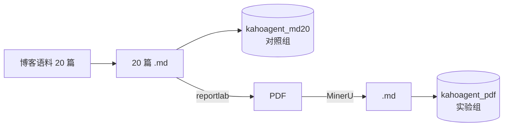

# PDF 语料检索评估结果

> **本文件手工编写，不要用 `eval.go -out` 直接覆盖。**
> 脚本生成的模板会把主语料的「降级验证」「Redis 缓存」两节常量一并写进来 ——
> 那两节数字是从别处誊录的、与本语料无关，留在这里就是假数据。
> 本文件只保留本次实测得到的数字。

**日期**：2026-09-04
**方案**：`docs/pdf-plan-b.md`（MinerU 离线预处理）

---

## 一句话结论

PDF 往返（Markdown → PDF → MinerU → Markdown）后，检索质量**与直接用
Markdown 入库基本持平**：hybrid-rrf 的 MRR 0.751 vs 0.757（-0.006），
Recall@5 0.547 vs 0.511（+0.036）。差异在噪声量级，PDF 支持可以接受。

---

## 实验设计：为什么必须有对照组

**PDF-20 的数字不能和主语料 77 篇的数字比。** 语料规模不同（284 vs 1307 块）、
golden set 不同（38 vs 78 条查询），两者差多少都无法归因 ——
分不清是「PDF 转换损失」还是「语料本来就不一样」。

所以建了对照组：**同样这 20 篇文档，以原始 Markdown 入库**。
两组唯一的变量就是「有没有经过 PDF 往返」，差异才能归因到转换本身。



对照组的 Markdown 直接取自博客源文件，与生成 PDF 时用的是同一批文件
（按 `converted/pdf-*.md` 的文件名去前缀反查，避免手工列表选错）。

### 三套存储完全隔离

| 语料 | PG database | Milvus collection | 配置文件 |
|---|---|---|---|
| 主语料 77 篇 | `kahoagent` | `kaho_documents` | `config.toml` |
| 对照组 20 篇 md | `kahoagent_md20` | `kaho_documents_md20` | `config.md20.toml` |
| 实验组 20 篇 pdf | `kahoagent_pdf` | `kaho_documents_pdf` | `config.pdf.toml` |

**PG 用独立 database 而非共用 `chunks` 表** —— 这是执行中对方案的修正。
原计划（`pdf-plan-b.md` §5）打算共用一张表、靠 `doc_id LIKE 'pdf-%'` 区分，
写配置时发现它与 §7 的停止条件「主语料评估数字发生变化就停」直接冲突：
**BM25 的 IDF 是全表统计量**，多灌 20 篇会改变每个词的文档频率，
主语料的 BM25 分数必然漂移 —— 那不是隔离失效，而是共用表的必然结果，
会让停止条件永远误报。换独立 database 的代价只是多一行 DSN。

---

## 主语料未受影响（C7 铁律）

入库前后各跑一次主语料评估，**质量指标逐位一致**：

| Method | Recall@5 前→后 | MRR 前→后 |
|---|---|---|
| `vector-only` | 0.314 → 0.314 | 0.660 → 0.660 |
| `bm25-only` | 0.363 → 0.363 | 0.723 → 0.723 |
| `hybrid-rrf` | 0.358 → 0.358 | 0.719 → 0.719 |

分类型 MRR 九项同样全部一致。只有耗时列有变动（机器负载），
`P99` 从 718ms 变为 204ms 之类的波动与语料无关。

行数核对：主库 1307 chunks / 77 docs 未变，且 `doc_id LIKE 'pdf-%'` 为 **0 行**；
PDF 库 284 chunks / 20 docs，`doc_id NOT LIKE 'pdf-%'` 为 **0 行**。双向都干净。

---

## 主结果：PDF vs 同源 Markdown

两组各 38 条查询（PDF 组 172 条标注，md 组 170 条）。

### 总体

| Method | Recall@5 (md → pdf) | MRR (md → pdf) |
|---|---|---|
| `vector-only` | 0.459 → **0.480** (+0.021) | 0.639 → **0.640** (+0.001) |
| `bm25-only` | 0.523 → **0.545** (+0.022) | 0.759 → **0.722** (−0.037) |
| `hybrid-rrf` | 0.511 → **0.547** (+0.036) | 0.757 → **0.751** (−0.006) |

> **两组的 Recall@5 上界几乎相同**（对照组 0.876 / PDF 组 0.873），
> 所以上表的 Recall 差值可以直接比较。
> 上界 = `mean(min(5,n)/n)`，两组 golden set 的平均相关块数分别是
> 4.47 与 4.53 —— 标注密度基本一致，这是对照成立的另一个前提。
>
> 换算成占上界的比例：hybrid-rrf 对照组 58%、PDF 组 63%。
>
> ⚠️ **注意上界随语料变化**：主语料 77 篇的上界只有 0.667
> （平均 8.18 个相关块，前 5 位装不下），所以 `eval-results.md` 里的
> 0.358 与这里的 0.511 **不能直接比大小** —— 分母的松紧程度不同。
> 这也是为什么本次必须建对照组而不能拿主语料当基线。

### 分类型 MRR

| Method | confusable | semantic | keyword |
|---|---|---|---|
| `vector-only` | 0.292 → 0.389 | 0.281 → 0.278 | 0.870 → 0.848 |
| `bm25-only` | 0.583 → 0.583 | 0.370 → 0.356 | 0.957 → 0.902 |
| `hybrid-rrf` | 0.500 → 0.533 | 0.444 → 0.370 | 0.946 → 0.957 |

> ⚠️ `confusable` 仅 6 条，单条对错就让该列变动 0.167；`semantic` 9 条，
> 变动粒度 0.111。**这两列的所有差异都小于其变动粒度**，只能看趋势不能比大小。
> `keyword` 23 条相对可信，PDF 组 bm25 掉 0.055 是全表最实的一处下降。

### 怎么读这组数字

**Recall 微升、MRR 微降**，两者方向相反，恰好说明差异不是「质量变化」：
PDF 组切出 284 块、md 组 299 块（**-5.0%**），块变少变大，
单块覆盖的内容更多 → 更容易被召回（Recall↑），但块内噪声也更多
→ 排序精度略降（MRR↓）。这是**分块粒度**的效应，不是抽取质量的效应。

块数差异来自转换时的结构损失：MinerU 漏判部分标题（约 9%），
漏判的标题不产生新的切分点，于是相邻两节合并成一块。

---

## 转换质量（步骤 3 验收）

`scripts/pdf/verify.py`，四项指标 + 30% 失败率阈值：

```
合计 14 份（另有 6 份不计入），失败 1 份，失败率 7.1%
平均标题召回 91.4% · 平均内容留存 149.8%
[OK] 失败率 7.1% < 30%，通过
```

6 份不计入的是源文正文不足 400 字的短文（作业、测试页），
**已在输出中逐条列出**，不是悄悄排除。

### 唯一失败样本的归因

`2026-5-27-the-problem-of-QuitOpencode-will-closeWezTerm-tab`，
`cjk_ratio` 0.14 触发阈值。查证结果：**不是转换失败，是判据的盲区**。

| | 源文 | 产物 |
|---|---|---|
| 中文字数 | 228 | 240 |
| ` ``` ` 围栏数 | 2 | 0 |

中文一个没丢。问题在 `verify.py` 的 `text_only()` 会剥掉代码块：
源文那段崩溃转储日志在围栏里，被剥掉了；MinerU 没把它识别成 code 块，
留在了正文里。于是分子含大段英文日志、分母不含，比值自然崩。

**没有据此改判据。** gate 已在 7.1% 通过，看到结果再调指标去拿 0%，
正是 `pdf-plan-b.md` §7 那条教训反对的做法。记录在案即可。

---

### 表格保真（方案 B 的核心卖点，单独验）

表格是选 MinerU 而非 Go 库的主要理由（`pdf-plan-b.md` §1 对比表），
但 `verify.py` 的四项指标都不针对表格 —— 表格整个丢掉，「内容留存」
只掉几个百分点，照样过阈值。所以单写了 `scripts/pdf/verify_tables.py`
做单元格级比对：

```
表格数量：源 15 → 产物 15
单元格保真：345/346 = 99.7%（另有 3 个 ASCII 图形不计入）
真实丢失 1 个单元格：interview-kafka-architecture.md 'Offset'
```

唯一的真实损失是 `interview-kafka-architecture` 的术语表丢了
`Offset` 一整行（含其说明格）—— 15 个表格里丢 1 行。

> 「3 个 ASCII 图形不计入」是有判据的：源文里的 TLS 握手时序图形如
> `| (选定算法+KeyShare)-----> |`，以 `|` 开头会被当成表格行。
> 判据是「格子里含连续 3 个以上的 `-` 或 `=` 画线」——
> 在全部 79 篇博客上验过，命中 16 个格子**全部**是握手时序图，零误伤。
> （第一版判据写的是「去掉标点后什么都不剩」，识别不出来 ——
> 那些格子里既有中文又有字母，剥完还剩 `选定算法KeyShare`。）

结论：表格能力确实兑现了，这是方案 B 相对 Go 库方案最直接的收益
（方案 A 需要自写 Rect 区域识别 + 线性化，估时 1 天）。

---

## 已知局限

1. **样本是自己生成的 PDF**，用 reportlab 从博客 Markdown 渲染。
   好处是有「已知正确答案」可比对（见 `scripts/pdf/README.md`），
   代价是**排版比真实 PDF 规整** —— 没有分栏、没有嵌入图片文字、
   没有扫描件。真实世界的 PDF 转换质量会低于这里的数字。
2. **未验证 OCR 路径**（扫描件），MinerU 支持但本次明确不启用。
3. **表格只验了内容保真，未验结构保真**。逐单元格比对能发现「格子丢了」，
   但发现不了「行列错位」—— 内容都在、位置串了的话，这项指标仍是 100%。
4. **未跑 `-rerank`**。两组都没跑，对比仍然成立，但缺少精排后的绝对值。
5. `confusable` / `semantic` 两类样本量不足以支撑结论，见上文提示。

---

## 复现

```bash
# 1. 建库
podman exec kaho-postgres createdb -U kaho -O kaho kahoagent_pdf
cp config.pdf.toml.example config.pdf.toml

# 2. 生成测试 PDF → 转换 → 验证（详见 scripts/pdf/README.md）
scripts/pdf/.venv/Scripts/mineru.exe -p scripts/pdf/testdata -o scripts/pdf/out -b pipeline -l ch
scripts/pdf/.venv/Scripts/python.exe scripts/pdf/convert.py scripts/pdf/out scripts/pdf/converted
scripts/pdf/.venv/Scripts/python.exe scripts/pdf/verify.py <博客目录> scripts/pdf/converted
scripts/pdf/.venv/Scripts/python.exe scripts/pdf/verify_tables.py <博客目录> scripts/pdf/converted

# 3. 入库 + 建 golden set + 评估（PDF 实验组）
KAHO_CONFIG=config.pdf.toml go run -tags=corpus ./scripts/eval/ingest_corpus.go scripts/pdf/converted
KAHO_CONFIG=config.pdf.toml go run -tags=buildgolden ./scripts/eval/build_golden.go -out scripts/eval/golden_set.pdf.json
KAHO_CONFIG=config.pdf.toml go run -tags=corpus ./scripts/eval/eval.go -golden scripts/eval/golden_set.pdf.json -out /tmp/pdf.md

# 4. 对照组（同样 20 篇，原始 Markdown）—— 数字可归因的前提
podman exec kaho-postgres createdb -U kaho -O kaho kahoagent_md20
cp config.md20.toml.example config.md20.toml
# 20 篇源文件按 converted/pdf-*.md 去前缀反挑，放到一个目录后：
KAHO_CONFIG=config.md20.toml go run -tags=corpus ./scripts/eval/ingest_corpus.go <20篇md目录>
KAHO_CONFIG=config.md20.toml go run -tags=buildgolden ./scripts/eval/build_golden.go -out scripts/eval/golden_set.md20.json
KAHO_CONFIG=config.md20.toml go run -tags=corpus ./scripts/eval/eval.go -golden scripts/eval/golden_set.md20.json -out /tmp/md20.md

# 5. 核对主语料未变（C7）
go run -tags=corpus ./scripts/eval/eval.go -out /tmp/main-after.md
go run -tags=milvusprobe ./scripts/spike/milvusprobe/main.go   # 双存储一致性
# PDF 组与对照组的 Milvus 一致性同样要各自验一遍：
KAHO_CONFIG=config.pdf.toml go run -tags=milvusprobe ./scripts/spike/milvusprobe/main.go
KAHO_CONFIG=config.md20.toml go run -tags=milvusprobe ./scripts/spike/milvusprobe/main.go
```

`KAHO_CONFIG` 是本次为隔离而启用的机制（`config.DefaultPath()`，
生产代码一直在用，评估脚本此前写死了 `config.toml`）。
**不要用「临时改 config.toml 再改回来」代替** —— 中途任何一步失败或忘了恢复，
后续入库就会静默写进错误的 collection，而 Milvus 是 upsert，写错不报错。
