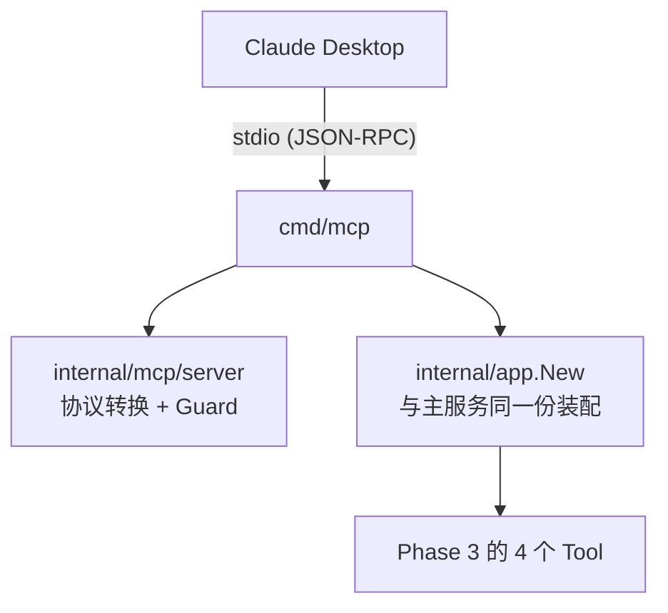

# Phase 4 验收证据

运行方式：

```bash
go test -race ./internal/mcp/server/          # 单元：Guard + 协议桥接
go test -tags=e2e -v ./cmd/mcp/               # 端到端：真起二进制走 stdio
```

## 架构：MCP 层不含业务逻辑



两个刻意的设计决定：

**1. 对任意 eino 工具通用，而不是给 4 个工具各写一段适配。**

理由不是"少写代码"。逐个适配意味着参数 schema 要在 MCP 侧再声明一遍，
两边迟早不一致 —— 而不一致的表现是**模型传了合法参数却被拒绝**，
协议层看着完全正常，极难排查。改为从 `ToolInfo.ParamsOneOf.ToJSONSchema()`
现场生成，则不可能不一致。

`TestServer_ExposesSchemaDerivedFromTheTool` 断言 `query` / `top_k` /
参数描述 / `required` 都从 eino 侧传到了 MCP 侧。

**2. 复用 `internal/app.New`，不单独搭一套。**

各自装配的话，两边的检索配置与降级策略迟早分叉；而 MCP 路径平时没人盯着，
分叉了也不会有人发现。为此给 `App` 加了 `Tools` 字段。

## 验收结果

| 验收项 | 测试 | 实测 |
|---|---|---|
| Claude Desktop 能 list 出 4 个 Tool | `TestMCPE2E_ListsFourTools` | ✅ 4 个全在，且都有描述 |
| 「搜索 Kafka 相关文档」成功调用并返回 | `TestMCPE2E_RAGQueryReturnsContent` | ✅ 返回 2450 字，含来源标注 |
| 并发 50 个 call：不 panic、排队而非报错 | `TestMCPE2E_FiftyConcurrentCalls` | ✅ 7.06s 全部成功，0 失败 |
| 审计日志完整且不污染 stdout | `TestMCPE2E_AuditLoggingDoesNotCorruptStdout` | ✅ 5 次调用后协议仍正常 |

单元测试 17 项全过（`-race`）。

### 为什么 e2e 必须测**编译好的二进制**

验收项是「Claude Desktop 配置后能 list 出 4 个 Tool」，而 Claude Desktop 是
**起一个子进程**通过 stdio 说话。这条路径上有一类 in-process 测试根本覆盖不到
的故障：任何往 stdout 写的东西（日志、`fmt.Println`、依赖库的告警）都会污染
JSON-RPC 协议流，表现为「工具莫名其妙不出现」。

所以 `connectStdio` 真的 `go build` 出二进制、真的起子进程、真的用官方 MCP
客户端连上去 —— 与 Claude Desktop 走完全相同的代码路径。

### 并发验收：一个差点自欺欺人的测试

第一版用 `file_search` 打并发，结果是：

```
50 concurrent calls in 10ms (protocol failures=0, tool errors=0)
```

**10ms 通过了，但这个数字本身就是问题**：并发上限是 20，50 个请求若真的排队，
不可能 10ms 跑完。原因是 `file_search` 打的是本地 httptest 替身，快到根本
排不上队 —— 测的只是"客户端能并发发请求"，**完全没碰到 Guard 的信号量**。

改用 `rag_query`（真实 Milvus + PG + 向量化，单次几百毫秒），并给每个请求
不同的查询词避免全部命中缓存：

```
50 concurrent calls in 7.056s (slowest single call 7.055s,
protocol failures=0, tool errors=0)
```

最慢的单次调用（7.055s）几乎横跨整个运行时长（7.056s）—— 它从头排到尾，
这才是排队真的发生了的证据。

## Guard 的三个设计细节

### 排队而非拒绝

```go
if err := g.sem.Acquire(ctx, 1); err != nil { ... }
```

拿不到令牌就等，而不是立刻返回"服务繁忙"。调用方是 AI 客户端，收到繁忙多半
会立刻重试，反而加重负载；而工具调用本来就是秒级的，排队几百毫秒对用户无感。
`Acquire` 在 ctx 取消时会返回，所以不会无限等下去
（`TestGuard_RespectsCallerCancellation`）。

### 超时从**拿到令牌之后**才开始计时

```go
if err := g.sem.Acquire(ctx, 1); err != nil { ... }
defer g.sem.Release(1)
callCtx, cancel := context.WithTimeout(ctx, g.timeout)   // ← 顺序是关键
```

若把排队时间算进超时预算，负载高时所有调用都会超时 —— 明明只是排队慢，
却表现为**工具全线故障**，排查方向会完全跑偏。
`TestGuard_TimeoutExcludesQueueTime` 专门钉住这个顺序：让一个调用排队 300ms
（超过 200ms 的超时预算），它仍必须成功。

### 审计只记参数哈希

用户的查询词可能包含个人信息、内部文件名，甚至误粘贴的密码。审计日志通常
保留很久且访问面更广，不该成为泄露源。哈希仍可用于「同样的调用出现了多少次」
这类排查。`TestGuard_AuditDoesNotLeakArguments` 验证原文不出现在日志里。

## 工具失败 = IsError，不是协议错误

```go
return errorResult(err.Error()), nil   // 而不是 return nil, err
```

返回 Go error 会变成 JSON-RPC **协议级**错误，客户端通常直接中断整轮对话；
而 `IsError` 只是"这个工具这次失败了"，模型能看到原因，自行决定改参数重试
还是如实告诉用户。这与 Phase 3 里工具「从不返回 error」是同一个道理
（eino 在 `compose/tool_node.go` 对工具 error 会中止整个节点）。

## 配置：`CLOUDKAHO_BASE_URL` 用的是"覆盖"而非"回退"

其余环境变量都是"配置留空才回退"，这一个反过来 —— 环境变量**覆盖**配置文件。

理由：指向哪个 CloudKaho 是**部署环境**的属性，不是代码的属性。容器里、CI 里、
测试里各不相同，而 `config.toml` 是同一份。若沿用"留空才回退"，配置文件一旦
写了值就再也没法从外部改 —— e2e 里就没法把子进程指向 httptest 替身。

## Claude Desktop 配置

```json
{
  "mcpServers": {
    "kahoagent": {
      "command": "A:\\dev_pjs\\KahoAgent\\bin\\kaho-mcp.exe",
      "cwd": "A:\\dev_pjs\\KahoAgent"
    }
  }
}
```

HTTP 模式：`kaho-mcp -transport=http -port=3000`

## 遗留

- [ ] `docs/demo.gif`（30 秒录屏）—— 需要人工在 Claude Desktop 里操作录制，
      自动化测试已覆盖同一条代码路径，但 GIF 本身要手动录
